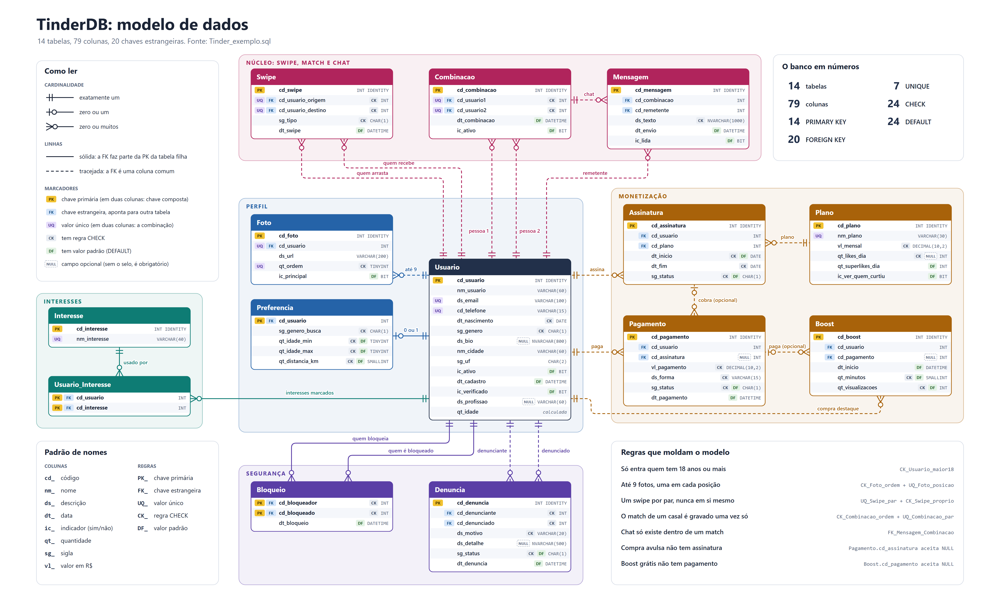

# Resumo de estudos: defesa do Desafio P2

**Banco TinderDB · SQL Server · defesa na segunda, 16/11/2026 · trio**

Este resumo junta o regulamento, a matéria das cinco aulas e o script do TinderDB em um só lugar, para estudar e ensaiar a defesa. O **Roteiro** diz quando estudar cada parte, e o **Questionário** testa se ficou. As referências do tipo "Aula 05, slide 12" apontam para os slides do professor, e "5.3" ou "seção 6.2" apontam para o `Tinder_exemplo.sql`.

> **Como usar.** Se só der tempo de ler uma coisa, leia as seções 1 a 3. Os resultados citados foram calculados para **16/11/2026** em uma simulação (SQLite) e conferidos no SQL Server 2022 Express. Mesmo assim, rode tudo uma vez no seu SSMS antes da defesa.

## 1. O desafio em 1 minuto

- **O que é.** O desafio "Por trás dos dados": cada equipe, de até 3 pessoas, recebeu por sorteio uma plataforma real e implementou, em SQL Server, um banco relacional inspirado nela. A nossa é o **Tinder**.
- **Quanto vale.** Até **8,0 pontos**, e **substitui a P2**. Quem faz o desafio e também a P2 perde as duas notas (§8).
- **Como é a defesa.** Direto no SQL Server: explicar a plataforma, apresentar as tabelas e os relacionamentos, executar os scripts de criação e manipulação, demonstrar consultas, executar transações e explicar as decisões técnicas (§6).
- **Desafio ao vivo.** O professor pode pedir uma consulta nova ou alterada, uma operação, ou fazer perguntas técnicas. **Todos** os integrantes participam e respondem (§6 e §7, item 9).
- **O que não se exige.** Diagramas, interface ou aplicativo (§5 e §7, item 8). O foco é o SQL.
- **Prazo.** A entrega e a apresentação acontecem na última aula antes da semana de provas. O envio dos scripts segue as orientações do professor (§9).

> **Atenção.** O regulamento pede **seis scripts** (criação, alteração, população, manipulação, consulta e transações) mais a demonstração (§5). Hoje o projeto está em um arquivo único, com sete seções. Confirmem com o professor como enviar. Separar o arquivo é simples e está descrito na seção 13.

## 2. O que o professor avalia

Cada linha liga um item do regulamento ao ponto do TinderDB que o atende e a uma frase pronta para falar.

| Item do regulamento | O que ele quer ver | Onde está no TinderDB | Frase pronta |
|---|---|---|---|
| §3 Escopo | Vários processos da plataforma, não uma função isolada | 14 tabelas em 5 áreas: perfil, interesses, núcleo (swipe, match e chat), monetização e segurança | "O banco cobre o ciclo completo do app: cadastro, descoberta, swipe, match, conversa, assinatura e moderação." |
| §4.1 Criação | `CREATE DATABASE`, `CREATE TABLE`, tipos, PK, FK, `NOT NULL`, `UNIQUE`, `CHECK`, `DEFAULT` | Seção 1, com 89 regras: 14 PK, 20 FK, 7 UNIQUE, 24 CHECK e 24 DEFAULT | "Todas as regras têm nome (PK_, FK_, UQ_, CK_, DF_), então o erro diz qual regra barrou." |
| §4.1 Alteração | `ALTER TABLE` | Seção 2, com 5 alterações: 2 colunas novas, 1 `ALTER COLUMN`, 1 coluna calculada e 1 `CHECK` novo | "A idade é uma coluna calculada: nunca fica desatualizada." |
| §4.2 Manipulação | `INSERT`, `UPDATE`, `DELETE` que representem situações reais, com dados fictícios | Seções 3 e 4: cadastro, edição de perfil, expiração de assinatura, banimento, "voltar" e unmatch | "Cada comando representa algo que acontece no app." |
| §4.3 Consultas | `SELECT`, `WHERE`, `ORDER BY`, `JOIN`, várias tabelas, `COUNT`, `SUM`, `AVG`, `GROUP BY`; perguntas reais | Seção 5, com 13 consultas | "Cada consulta responde uma pergunta do app: a pilha de perfis, quem curtiu você, ranking, receita e moderação." |
| §4.4 Transações | `BEGIN TRANSACTION`, `COMMIT`, `ROLLBACK`, coerentes com a plataforma | Seção 6: 6.1 `COMMIT` (like vira match), 6.2 `ROLLBACK` (pagamento recusado) e 6.3 `TRY/CATCH` (compra de boost) | "É tudo ou nada: ou grava o like e o match, ou não grava nenhum." |
| §4.5 Integridade | Pelo menos uma operação inválida barrada | Seção 7, com 9 testes | "São nove tentativas inválidas, e o banco barra todas." |
| §5 Entregáveis | 6 scripts e a demonstração, organizados e reproduzíveis | Um arquivo com 7 seções, que apaga e recria o banco a cada execução | "Roda de ponta a ponta com F5 e sempre volta ao mesmo estado." |
| §6 Defesa | Explicar, apresentar, executar, demonstrar, justificar; desafio ao vivo | Seção 3 deste resumo | "Qualquer um de nós explica qualquer parte." |
| §7 Regras gerais | Dados fictícios, scripts executáveis, todos conhecem o banco | Dados inventados e script reproduzível | "Nenhum dado é real." |

## 3. A defesa dividida no trio

A sugestão abaixo dura cerca de 20 minutos e deixa margem para o desafio ao vivo. Troquem a divisão se preferirem, mas lembrem que **qualquer um pode ser chamado a responder qualquer parte**.

Antes de começar, rode o script inteiro uma vez, para ter certeza de que o banco está criado. Na apresentação, execute **por seleção de trecho**: selecione as linhas e aperte F5.

### Integrante 1. A plataforma e a estrutura (cerca de 6 min)

- **Falar (30 s).** O que é o Tinder: perfil e preferências, pilha de perfis, swipe, match, chat, assinaturas e boost, bloqueio e denúncia. O banco cobre todos esses processos.
- **Mostrar.** O diagrama do modelo (a imagem da seção 4) e, no SSMS, as 14 tabelas no Pesquisador de Objetos.
- **Executar.** A seção 1 (linhas 26 a 235) e a seção 2 (linhas 238 a 260).
- **Explicar.** O padrão de nomes da matéria (`cd_`, `nm_`, `ds_`, `dt_`, `ic_`, `qt_`, `sg_`, `vl_`), as regras com nome, `IDENTITY`, `DECIMAL` para dinheiro e `NVARCHAR` onde há emoji. Dizer por que a tabela se chama `Combinacao` e não `Match`: o próprio SQL Server usa a palavra `MATCH` (em consultas de grafo), e o nome diferente evita conflito.
- **Pergunta provável.** "Por que `Combinacao` tem `cd_usuario1 < cd_usuario2`?" A resposta está na seção 8.

### Integrante 2. Dados e consultas do dia a dia (cerca de 7 min)

- **Executar.** A seção 3 (linhas 267 a 397) e a seção 4 (linhas 401 a 460). A seção 4 tem um `DECLARE @nova`, então selecione as linhas 405 a 418 de uma vez.
- **Explicar o `UPDATE` e o `DELETE`.** Todos têm `WHERE`. O unmatch apaga as mensagens (filhas) antes do match (pai).
- **Consultas 5.1 a 5.6, uma pergunta real cada.** 5.1 perfis ativos de Santos. 5.2 a pilha de perfis. 5.3 os matches da Ana com a contagem de mensagens. 5.4 a conversa. 5.5 o "veja quem curtiu você" do plano Gold. 5.6 o ranking de curtidas.
- **Pergunta provável.** "Como a pilha de perfis decide quem aparece?" Resposta: a 5.2 exige que o candidato esteja ativo, seja do mesmo estado, que cada um procure o gênero do outro, que a idade de cada um caiba na faixa do outro, que ainda não haja swipe e que não haja bloqueio.

### Integrante 3. Relatórios, transações e integridade (cerca de 7 min)

- **Consultas 5.7 a 5.13.** Receita por plano, usuários e idade média por gênero, interesses populares, interesses em comum, mensagens não lidas, matches sem conversa e o painel de moderação com `HAVING`.
- **Seção 6.** A 6.1 (`COMMIT`: o like vira match), a 6.2 (`ROLLBACK`: cartão recusado, mostrando o `SELECT` de dentro e o de fora da transação) e a 6.3 (`TRY/CATCH`).
- **Seção 7.** Rodar 7.1, 7.2, 7.6 e 7.9 dizendo o número do erro (547 ou 2627) e a regra que barrou. No fim, mostrar as duas conferências: 12 usuários e 2 swipes da Ana.

### Armadilhas da apresentação ao vivo

- **Banco errado.** Se a barra mostra `master`, escolha `TinderDB` na lista ou rode `USE TinderDB;`.
- **Variável que some.** O `DECLARE` vale só até o `GO`. Selecione o trecho inteiro.
- **Transação aberta.** `BEGIN TRANSACTION` sem `COMMIT` ou `ROLLBACK` deixa a aba presa. Confira com `SELECT @@TRANCOUNT;`.
- **Rodar duas vezes.** O cadastro da Larissa dá erro de `UNIQUE` na segunda vez. Para voltar ao início, rode o script inteiro.
- **Erros vermelhos.** Os da seção 7 são esperados. Avise a turma antes de rodar.
- **Letra pequena.** Aumente o zoom do editor (caixa no canto inferior esquerdo ou Ctrl com a roda do mouse).
- **Resultado em texto.** `Ctrl+D` volta para grade, e `Ctrl+R` mostra ou esconde o painel de resultados.

> **Dica.** Para voltar ao estado inicial, basta apertar F5 no `Tinder_exemplo.sql` inteiro. O script derruba e recria o `TinderDB` (usa `SET SINGLE_USER WITH ROLLBACK IMMEDIATE` para expulsar outras conexões), então dá para rodar quantas vezes quiser.

## 4. Mapa do banco



O diagrama acima mostra as 14 tabelas e as 20 ligações. A tabela `Usuario` é o centro: **15 das 20 chaves estrangeiras** apontam para ela.

| Tabela | Área | O que guarda | Chave primária | Aponta para | Regras que valem citar |
|---|---|---|---|---|---|
| `Plano` | Monetização | Free, Plus, Gold e Platinum | `cd_plano` | nada | nome único; valor maior ou igual a 0; likes por dia NULL significa ilimitado |
| `Usuario` | Perfil | A pessoa | `cd_usuario` | nada | e-mail e telefone únicos; gênero M, F ou N; maior de 18; idade calculada |
| `Foto` | Perfil | Fotos do perfil | `cd_foto` | `Usuario` | uma foto por posição (única por usuário); posição de 1 a 9 |
| `Preferencia` | Perfil | O que a pessoa procura | `cd_usuario` (é PK e FK) | `Usuario` | gênero M, F ou T; idade mínima 18; máxima maior que a mínima; distância de 1 a 160 |
| `Interesse` | Interesses | Lista de interesses | `cd_interesse` | nada | nome único |
| `Usuario_Interesse` | Interesses | Quem marcou qual interesse | (`cd_usuario`, `cd_interesse`) | `Usuario`, `Interesse` | PK composta: não repete o par |
| `Swipe` | Núcleo | Like (L), dislike (D) ou superlike (S) | `cd_swipe` | `Usuario` (origem e destino) | um swipe por par; tipo válido; não dá swipe em si mesmo |
| `Combinacao` | Núcleo | O match | `cd_combinacao` | `Usuario` (usuário 1 e 2) | par único; `cd_usuario1 < cd_usuario2` |
| `Mensagem` | Núcleo | O chat de um match | `cd_mensagem` | `Combinacao`, `Usuario` (remetente) | texto não vazio |
| `Assinatura` | Monetização | Quem assina qual plano | `cd_assinatura` | `Usuario`, `Plano` | status A, C ou E; fim depois do início |
| `Pagamento` | Monetização | Cobranças de assinatura ou avulsas | `cd_pagamento` | `Usuario`, `Assinatura` (pode ser NULL) | valor maior que 0; forma e status válidos |
| `Boost` | Monetização | Perfil em destaque | `cd_boost` | `Usuario`, `Pagamento` (pode ser NULL) | minutos maiores que 0; visualizações maiores ou iguais a 0 |
| `Bloqueio` | Segurança | Quem bloqueou quem | (`cd_bloqueador`, `cd_bloqueado`) | `Usuario` (os dois) | não bloqueia a si mesmo |
| `Denuncia` | Segurança | Denúncias para a moderação | `cd_denuncia` | `Usuario` (denunciante e denunciado) | motivo e status válidos; não denuncia a si mesmo |

**Tipos de relacionamento para citar:**

- **1:N.** `Usuario` e `Foto`; `Plano` e `Assinatura`; `Combinacao` e `Mensagem`; `Assinatura` e `Pagamento` (opcional, porque há pagamento avulso); `Pagamento` e `Boost` (opcional, porque há boost grátis).
- **1:1.** `Usuario` e `Preferencia`, em que a PK também é FK. Na prática é 1 para 0 ou 1, porque nada obriga o usuário a ter preferência.
- **N:N.** `Usuario` e `Interesse`, resolvido por `Usuario_Interesse`. E `Usuario` com `Usuario` em `Swipe`, `Combinacao`, `Bloqueio` e `Denuncia`, que têm duas FKs para a mesma tabela.

## 5. A matéria e o projeto

| Aula | Assunto | Sintaxe vista na aula | Onde aparece no TinderDB | Pergunta típica |
|---|---|---|---|---|
| 01 | SQL é declarativa. Grupos DDL, DML, TCL, DCL e DQL. Transação como unidade lógica de trabalho | Sem sintaxe; criar o banco de funcionários e departamentos | DDL nas seções 1 e 2, DML nas 3 e 4, DQL na 5, TCL na 6. O DCL não é usado | "Em qual grupo está o `ALTER TABLE`?" |
| 02 | Constraints: PK, FK, UNIQUE, CHECK, NOT NULL e DEFAULT. `INSERT` com e sem lista de colunas. `SELECT *` e por colunas | `CREATE TABLE t (cd INT PRIMARY KEY, ...)` e `INSERT INTO t (c1, c2) VALUES (...)` | Seção 1, com 89 regras nomeadas. Seção 3, com 14 `INSERT` | "Qual a diferença entre PK e UNIQUE?" "Por que listar as colunas no `INSERT`?" |
| 03 | `WHERE` com `=`, `>`, `>=`, `<`, `<=`, `<>`, `and`, `or`, `in`, `like`, `is null` e `between`. `ORDER BY` com `ASC` e `DESC` | `SELECT ... FROM ... WHERE ... ORDER BY ...` | 5.1, 5.2 (`IN`, `BETWEEN`, `NOT EXISTS`) e 5.5 | "Como listar quem não tem bio?" |
| 04 | `UPDATE` e `DELETE`, com o aviso sobre o `WHERE`. `COMMIT` e `ROLLBACK` | `UPDATE t SET c = v WHERE ...`, `DELETE FROM t WHERE ...` e `BEGIN TRANSACTION; ...; COMMIT;` | Seção 4, com 7 `UPDATE` e 5 `DELETE`. Seção 6, com as 3 transações | "O que acontece com `UPDATE` sem `WHERE`?" |
| 05 | `INNER`, `LEFT`, `RIGHT` e `FULL JOIN`. `COUNT`, `SUM`, `AVG`, `MAX` e `MIN`. `GROUP BY` e `HAVING` | `FROM a INNER JOIN b ON ...`, `GROUP BY c` e `HAVING condição` | 5.2 a 5.4, 5.6, 5.7, 5.11 e 5.12 (junções), 5.13 (`HAVING`) | "Quando usar `HAVING` em vez de `WHERE`?" |

## 6. O que o script usa e os slides não mostram

Se o professor perguntar "o que é isso?", a resposta é uma frase.

| Comando | Em uma frase | Onde aparece |
|---|---|---|
| `GO` | Separa o script em lotes. É do SSMS, não é SQL. Variáveis morrem no `GO` | Em todo o script |
| `IDENTITY(1,1)` | Número automático que começa em 1 e sobe de 1 em 1 | PK de 11 tabelas |
| `SCOPE_IDENTITY()` | Devolve o último número `IDENTITY` gerado no escopo | Seção 4 e 6.3 |
| `DECLARE @v tipo` | Cria uma variável, que vale até o `GO` | Seções 4, 6.1 e 6.2 |
| `GETDATE()` | Data e hora atuais do servidor | `DEFAULT`, maioridade, idade e expiração |
| `DATEADD` e `DATEDIFF` | Somam tempo a uma data e calculam a diferença entre datas | Maioridade, idade calculada e 6.2 |
| `CAST(x AS tipo)` | Converte um valor de um tipo para outro | 5.8, `DEFAULT` de datas e 6.2 |
| `IIF(cond, a, b)` | "Se a condição, então a; senão, b" | 5.3, 5.5, 5.6 e 5.11 |
| `EXISTS` e `NOT EXISTS` | Verdadeiro se a subconsulta devolve (ou não) alguma linha | 5.2, 5.5 e 6.1 |
| Coluna calculada | `ADD qt_idade AS (...)`: o banco calcula a cada consulta | Seção 2 |
| `NVARCHAR` e `N'texto'` | Texto Unicode (aceita emoji). O `N` vai antes do texto | Bio, mensagem e detalhe da denúncia |
| `PRINT` | Escreve na aba Mensagens | 6.1, 6.2 e 6.3 |
| `TRY ... CATCH` e `ERROR_MESSAGE()` | Se der erro no `TRY`, o fluxo vai para o `CATCH` | 6.3 |
| `@@TRANCOUNT` | Quantas transações estão abertas | 6.3 |
| `SET SINGLE_USER WITH ROLLBACK IMMEDIATE`, `DB_ID` e `USE` | Expulsa conexões para poder apagar o banco; testa se ele existe; escolhe o banco | Início da seção 1 |
| `LEN` | Tamanho do texto, sem contar espaços no fim | `CK_Mensagem_texto` |
| `CONSTRAINT nome` | Dá nome às regras. Os slides escrevem a regra direto na coluna, sem nome | Seção 1 |
| Tipos `CHAR`, `TINYINT`, `SMALLINT`, `BIT`, `DECIMAL(10,2)`, `DATE` e `DATETIME` | Os tipos escolhidos para cada coluna (veja a seção 8) | Seção 1 |

## 7. O que os slides ensinam e o script não usa

É aqui que o desafio ao vivo costuma pegar quem estudou só o próprio script. Treine cada item com o exercício indicado.

| Item | O que é | Exemplo no TinderDB | Exercício |
|---|---|---|---|
| `LIKE` | Busca por trecho de texto: `%` casa qualquer sequência e `_` casa um caractere | Bios que contêm "leio": `WHERE ds_bio LIKE '%leio%'` | A1 |
| `IS NULL` e `IS NOT NULL` | Testam ausência de valor. O script só usa na 5.12 e em um `CHECK` | Quem não tem bio: `WHERE ds_bio IS NULL` | A2 |
| `MAX` e `MIN` | Maior e menor valor de uma coluna | Plano mais caro e mais barato | A5 |
| `RIGHT JOIN` | Mantém todas as linhas da tabela da direita | Planos com a contagem de assinaturas ativas, inclusive zero | B3 |
| `FULL JOIN` | Mantém as linhas sem par dos dois lados | Pagamentos e boosts lado a lado | B4 |
| `INSERT` sem lista de colunas | Os valores seguem a ordem exata da tabela | Criar o plano "Diamond" | D5 |
| Ponto de salvamento | Desfaz só parte da transação: `SAVE TRANSACTION` e `ROLLBACK TRANSACTION nome` | Reajuste de dois planos, desfazendo só um | F1 |
| DCL: `GRANT` e `REVOKE` | Concede e retira permissões | Só teoria, mostrado abaixo | Quiz |

Exemplo de sintaxe do DCL, só para reconhecer (precisa de um usuário ou papel já criado):

```sql
GRANT SELECT ON Usuario TO moderador;      -- concede
REVOKE SELECT ON Usuario FROM moderador;   -- retira
```

## 8. Perguntas prováveis

As dez mais prováveis estão marcadas com **(top 10)**. Responda em voz alta antes de abrir.

### Conceitos das aulas

<details>
<summary>Qual a diferença entre DDL, DML, DQL, TCL e DCL? (top 10)</summary>

DDL define a estrutura (`CREATE`, `ALTER`, `DROP`). DML mexe nos registros (`INSERT`, `UPDATE`, `DELETE`). DQL consulta (`SELECT`). TCL controla transações (`COMMIT`, `ROLLBACK` e pontos de salvamento). DCL controla permissões (`GRANT`, `REVOKE`). No projeto: seções 1 e 2 são DDL, 3 e 4 são DML, 5 é DQL e 6 é TCL. O DCL não é usado. Os slides escrevem "TLC", mas a sigla comum é TCL.

</details>

<details>
<summary>Qual a diferença entre PRIMARY KEY e UNIQUE? (top 10)</summary>

Os dois impedem repetição. A PK identifica a linha, só existe uma por tabela e não aceita NULL. O UNIQUE pode existir várias vezes na tabela e aceita um NULL. No projeto, `cd_usuario` é PK, e `ds_email` e `cd_telefone` são UNIQUE.

</details>

<details>
<summary>O que é uma FOREIGN KEY e por que o `DELETE` do teste 7.9 falha? (top 10)</summary>

A FK garante que o valor exista na tabela apontada e impede apagar o registro "pai" enquanto houver "filhos". A Ana tem fotos, swipes e matches apontando para ela, então o banco barra com o erro 547. Para apagar, é preciso remover antes os filhos ou só desativar a conta com `ic_ativo = 0`.

</details>

<details>
<summary>Como o banco sabe que duas pessoas deram match? (top 10)</summary>

Na transação 6.1: grava o like, confere com `IF EXISTS` se o outro já tinha dado like ou superlike e, se sim, insere a linha em `Combinacao`. Tudo dentro de `BEGIN TRANSACTION ... COMMIT`, para não sobrar like recíproco sem match.

</details>

<details>
<summary>Qual a diferença entre WHERE e HAVING?</summary>

O `WHERE` filtra linhas antes de agrupar. O `HAVING` filtra os grupos depois do `GROUP BY` e por isso aceita funções como `COUNT` e `SUM`. Na 5.13, "quem recebeu 2 ou mais denúncias" só pode ser escrito no `HAVING`.

</details>

<details>
<summary>Qual a diferença entre INNER, LEFT, RIGHT e FULL JOIN?</summary>

`INNER` devolve só o que casa nos dois lados. `LEFT` mantém tudo da tabela da esquerda e preenche NULL à direita quando não há par. `RIGHT` é o espelho. `FULL` mantém o que sobra dos dois lados. Exemplo do projeto: a 5.12 usa `LEFT JOIN` com `IS NULL` para achar matches sem mensagem.

</details>

<details>
<summary>Qual a diferença entre `COUNT(*)` e `COUNT(coluna)`?</summary>

`COUNT(*)` conta linhas. `COUNT(coluna)` conta só os valores não nulos. Num `LEFT JOIN`, quem não tem par aparece com NULL: `COUNT(*)` conta essa linha (dá 1) e `COUNT(coluna)` não (dá 0). Por isso a 5.3 usa `COUNT(m.cd_mensagem)`.

</details>

<details>
<summary>O que acontece com `UPDATE` ou `DELETE` sem `WHERE`? (top 10)</summary>

Atingem todas as linhas da tabela, e o SQL Server executa sem avisar. É o aviso em vermelho da Aula 04. No script, todos os `UPDATE` e `DELETE` têm `WHERE`, e o reajuste do Gold usa `WHERE nm_plano = 'Gold'`.

</details>

<details>
<summary>O que é uma transação? Quando usar `COMMIT` e `ROLLBACK`? (top 10)</summary>

É um conjunto de comandos tratado como uma unidade: todos acontecem ou nenhum acontece. `COMMIT` confirma e torna permanente. `ROLLBACK` desfaz tudo desde o `BEGIN TRANSACTION`. No projeto, a 6.1 confirma (like e match), e a 6.2 desfaz (cartão recusado, então a assinatura não pode ficar).

</details>

<details>
<summary>Por que a 6.3 usa `TRY/CATCH` e a 6.1 e a 6.2 não? (top 10)</summary>

Violar uma regra cancela só o comando que falhou, e a transação continua aberta. A 6.3 trata isso: o erro leva ao `CATCH`, que dá `ROLLBACK` e desfaz também o pagamento. Nas 6.1 e 6.2 os comandos do teste foram escolhidos para dar certo. Resposta honesta: "em produção usaríamos `TRY/CATCH` com `SET XACT_ABORT ON` nas três". A correção está na seção 9.

</details>

<details>
<summary>Por que o teste 7.2 barra `ANA.SOUZA@email.com`, que está escrito diferente?</summary>

O SQL Server, por padrão, não diferencia maiúscula de minúscula (collation "CI"). Para o `UNIQUE`, os dois e-mails são o mesmo valor.

</details>

### Decisões do modelo

<details>
<summary>Por que existe `Combinacao` separada de `Swipe`?</summary>

O match é um objeto do negócio: tem data própria, tem um chat (`Mensagem` precisa de uma FK para apontar) e pode ser desfeito. Dá para descobrir o match olhando os swipes, mas isso não permite pendurar mensagens nele.

</details>

<details>
<summary>Por que `CHECK (cd_usuario1 < cd_usuario2)` em `Combinacao`? (top 10)</summary>

Para o casal só poder ser gravado em uma ordem: (1, 2) e nunca (2, 1). O `UNIQUE` sozinho trataria os dois pares como diferentes. De quebra, impede o match consigo mesmo.

</details>

<details>
<summary>Por que `qt_idade` é uma coluna calculada? (top 10)</summary>

Uma idade gravada fica errada a cada aniversário. Calculada a partir de `dt_nascimento` e da data de hoje, está sempre atual. Se o professor lembrar que o slide guarda `qt_idade` como número: serve para exercício, mas envelhece.

</details>

<details>
<summary>Por que `DECIMAL(10,2)` e não `MONEY` ou `FLOAT`? (top 10)</summary>

`DECIMAL(10,2)` guarda exatamente duas casas (reais e centavos) e é padrão ANSI, então funciona em outros bancos. `FLOAT` tem erro de arredondamento. `MONEY` existe no SQL Server (o TP04 usa), mas tem quatro casas fixas e arredondamentos surpreendentes em contas com multiplicação e divisão.

</details>

<details>
<summary>Por que `NVARCHAR` na bio e na mensagem, e `VARCHAR` no resto?</summary>

`NVARCHAR` é Unicode e aceita emoji, que é o que as pessoas escrevem em bio e chat. `VARCHAR` ocupa metade do espaço e basta para os outros textos. Valores `NVARCHAR` levam um `N` na frente: `N'texto'`.

</details>

<details>
<summary>Por que `IDENTITY` nas chaves primárias?</summary>

O banco gera o código sozinho, sem ninguém digitar e sem repetir. Cuidado com a precisão: quem impede a repetição é a PK, não o `IDENTITY`. O número também não volta atrás depois de um `ROLLBACK`.

</details>

<details>
<summary>Por que não usar `ON DELETE CASCADE`?</summary>

`Swipe`, `Combinacao`, `Bloqueio` e `Denuncia` têm duas FKs para `Usuario`, e o SQL Server não aceita cascata com "múltiplos caminhos". Além disso, apagar um usuário e levar junto as denúncias contra ele seria perigoso.

</details>

<details>
<summary>Por que desativar (`ic_ativo = 0`) em vez de apagar o usuário?</summary>

Para guardar histórico e permitir a moderação. O usuário banido some do app, mas os dados continuam para consulta.

</details>

<details>
<summary>Por que `Preferencia` é uma tabela separada, com a PK igual à FK?</summary>

São dados de outro assunto (o que a pessoa busca, e não quem ela é), e a relação é 1 para 1. Isso deixa a tabela `Usuario` mais limpa.

</details>

<details>
<summary>Por que `Usuario_Interesse`?</summary>

Resolve a relação N:N: um usuário tem vários interesses e cada interesse é de vários usuários. A PK composta impede repetir o par. Sem ela, `Usuario` teria `interesse1`, `interesse2`, `interesse3`, o que quebra a 1ª Forma Normal.

</details>

<details>
<summary>Por que dar nome às regras (`CONSTRAINT PK_...`)?</summary>

A mensagem de erro diz exatamente qual regra foi violada. Sem nome, o SQL Server inventa algo como `CK__Usuario__4F7CD00D`. O nome também permite remover a regra depois com `DROP CONSTRAINT`.

</details>

<details>
<summary>Quando usar `DATE` e quando usar `DATETIME`?</summary>

`DATE` quando só importa o dia (nascimento, início e fim da assinatura). `DATETIME` quando importa a hora (mensagem, swipe, match).

</details>

<details>
<summary>Por que o status é `CHAR` com `CHECK` e não uma tabela de status?</summary>

São poucos valores fixos (A, C e E, por exemplo). A regra fica simples, e o `CHECK` garante que não entre valor inválido.

</details>

<details>
<summary>Por que `Pagamento` guarda o valor, se `Plano` já tem o preço?</summary>

Não é redundância: o valor pago é o preço **naquele dia**. Se o plano mudar de preço (como no reajuste de 10% do Gold), o histórico continua certo.

</details>

### E se o professor pedir...

<details>
<summary>...para apagar a Ana?</summary>

O banco barra (teste 7.9). Mostre a ordem certa, filhas primeiro (`Swipe`, `Foto`, `Mensagem` e assim por diante) e só no fim `Usuario`, dentro de uma transação, ou explique que o app desativa a conta. O exercício D4 faz isso para o Ricardo.

</details>

<details>
<summary>...uma coluna nova?</summary>

`ALTER TABLE Usuario ADD qt_altura_cm SMALLINT NULL CONSTRAINT CK_Usuario_altura CHECK (qt_altura_cm BETWEEN 100 AND 250);` e um `GO` antes de usar a coluna. Exercício E1.

</details>

<details>
<summary>...quantos matches cada usuário tem?</summary>

`LEFT JOIN` de `Usuario` com `Combinacao` usando `ON u.cd_usuario IN (c.cd_usuario1, c.cd_usuario2)`, com `COUNT(c.cd_combinacao)` e `GROUP BY u.cd_usuario, u.nm_usuario`. Exercício B8.

</details>

<details>
<summary>...e se o script quebrar no meio?</summary>

Aperte F5 de novo: ele apaga e recria o `TinderDB`. Se aparecer erro de banco em uso, feche as outras abas e rode outra vez.

</details>

## 9. Pontos fracos conhecidos

Ninguém é pego de surpresa. Se o professor apontar um destes, a resposta honesta é "sabemos, e a correção é esta". Os primeiros afetam a defesa. Os do fim só importariam em produção.

### Afetam a defesa

1. **As transações 6.1 e 6.2 não tratam erro.** Só a 6.3 usa `TRY/CATCH`. *Correção:* `TRY/CATCH` com `SET XACT_ABORT ON`, no molde da 6.3 (código abaixo).
2. **As consultas 5.5 e 5.9 mostram perfis banidos e bloqueados**, e a 5.6 conta likes de quem foi banido. *Correção:* filtrar `ic_ativo = 1` e a tabela `Bloqueio` (código abaixo).
3. **O unmatch usa `DELETE` e ignora `Combinacao.ic_ativo`.** As mensagens somem, e uma denúncia perde a prova. *Resposta:* "deixamos o `DELETE` para mostrar a ordem filha e depois mãe, da Aula 04". *Correção:* `UPDATE Combinacao SET ic_ativo = 0` (código abaixo) e filtrar `c.ic_ativo = 1` nas consultas 5.11 e 5.12.
4. **Os resultados dependem da data de execução.** Assinaturas e pagamentos têm datas fixas de 2026, e idade e expiração usam `GETDATE()`. *Resposta:* os resultados da seção 10 valem de 11/11 a 15/12/2026. *Correção:* datas relativas com `DATEADD`.
5. **Agrupar só por nome junta homônimos** (5.11 e consultas prontas do material de apoio). *Correção:* `GROUP BY u.cd_usuario, u.nm_usuario`.
6. **A 6.2 apaga também o registro do pagamento recusado**, porque o `ROLLBACK` desfaz tudo. *Correção:* gravar a tentativa recusada depois do `ROLLBACK`, sem assinatura.
7. **Faltam regras que cruzam linhas ou tabelas.** O banco aceita duas fotos principais, duas assinaturas ativas, pagamento na assinatura de outra pessoa, mensagem de quem está fora do match e boost com pagamento recusado. *Resposta:* "um `CHECK` só enxerga uma linha". *Correção:* índice único filtrado e chave estrangeira composta. O material de apoio diz que isso exigiria `TRIGGER`, mas uma FK composta com uma tabela de participantes resolve sem trigger.
8. **Faltam testes na seção 7:** match invertido, match repetido, assinatura que termina antes de começar, pagamento de valor zero e décima foto. *Resposta:* "mostramos ao vivo". Veja os exercícios G4 e E1 para o formato.

### Só em produção

9. **Sem índices** além dos de PK e UNIQUE. O SQL Server não cria índice para FK sozinho. Em escala, "quem curtiu você" e a abertura de um chat leriam a tabela inteira.
10. **Concorrência.** Dois likes no mesmo instante podem gerar deadlock ou perder o match. Uma saída é bloquear o par com `sp_getapplock` antes de gravar.
11. **Distância.** `qt_distancia_km` é gravada, mas a pilha filtra pelo estado. O correto seria guardar a localização com o tipo `geography` e comparar a distância.
12. **Privacidade (LGPD).** Telefone, e-mail, data de nascimento, mensagens e preferências podem revelar dado sensível. `ic_ativo = 0` não elimina o dado. Faltam rotina de anonimização e perfis de acesso.
13. **Tipos.** `DATETIME` com `GETDATE()` depende do fuso do servidor (o melhor seria `DATETIME2` com UTC). `INT` em `Swipe` e `Mensagem` acaba em 2,1 bilhões de linhas (o melhor seria `BIGINT`). `VARCHAR` em nome perde letras fora do Latin-1.
14. **Pontos do modelo.** O plano Free não está ligado a ninguém. `sg_uf` aceita qualquer par de letras. A cidade é texto livre. A preferência só aceita M, F ou T. `ic_ativo = 0` não distingue banido de conta encerrada. `Denuncia` não guarda quem moderou nem quando resolveu.
15. **Detalhes.** O `CHECK` da mensagem barra espaços, mas aceita tab e quebra de linha. Nada obriga o perfil a ter foto principal. A 6.2 digita o preço 54.89 em vez de lê-lo em `Plano`. As consultas 5.5, 5.10 e 5.12 não têm `ORDER BY`, então a ordem das linhas não é garantida.

### Como seriam as três correções mais importantes

<details>
<summary>Ver o código das correções (transação 6.1, consulta 5.5 e unmatch)</summary>

**6.1 com tratamento de erro:**

```sql
SET XACT_ABORT ON;
DECLARE @origem INT = 2, @destino INT = 9;

BEGIN TRY
    BEGIN TRANSACTION;

        INSERT INTO Swipe (cd_usuario_origem, cd_usuario_destino, sg_tipo)
        VALUES (@origem, @destino, 'L');

        IF EXISTS (SELECT 1 FROM Swipe
                   WHERE cd_usuario_origem = @destino
                     AND cd_usuario_destino = @origem
                     AND sg_tipo IN ('L', 'S'))
        BEGIN
            INSERT INTO Combinacao (cd_usuario1, cd_usuario2)
            VALUES (IIF(@origem < @destino, @origem, @destino),
                    IIF(@origem < @destino, @destino, @origem));
            PRINT 'Deu match!';
        END

    COMMIT;
END TRY
BEGIN CATCH
    IF @@TRANCOUNT > 0 ROLLBACK;
    PRINT 'Swipe cancelado: ' + ERROR_MESSAGE();
END CATCH;
```

**5.5 sem perfis banidos nem bloqueados:**

```sql
SELECT u.nm_usuario, u.qt_idade, IIF(s.sg_tipo = 'S', 'Superlike', 'Like') AS ds_tipo
FROM Swipe s
JOIN Usuario u ON u.cd_usuario = s.cd_usuario_origem
WHERE s.cd_usuario_destino = 2
  AND s.sg_tipo IN ('L', 'S')
  AND u.ic_ativo = 1
  AND NOT EXISTS (SELECT 1 FROM Swipe r
                  WHERE r.cd_usuario_origem = 2
                    AND r.cd_usuario_destino = s.cd_usuario_origem)
  AND NOT EXISTS (SELECT 1 FROM Bloqueio b
                  WHERE (b.cd_bloqueador = 2 AND b.cd_bloqueado = s.cd_usuario_origem)
                     OR (b.cd_bloqueador = s.cd_usuario_origem AND b.cd_bloqueado = 2));
```

**Unmatch sem perder o histórico**, no lugar dos dois `DELETE` da seção 4:

```sql
UPDATE Combinacao SET ic_ativo = 0 WHERE cd_combinacao = 3;
```

Se aplicarem esta, acrescentem `AND c.ic_ativo = 1` nas consultas 5.11 e 5.12. Estes trechos foram conferidos em simulação, mas não executados no SQL Server: rodem no SSMS antes de confiar neles.

</details>

## 10. Resultados esperados em 16/11

Valem para quem rodou o script **de 11/11 a 15/12/2026**, depois de executar o arquivo inteiro. O SSMS mostra decimais com ponto (49.90) e pode exibir mais casas em médias. Nas consultas sem `ORDER BY` (5.5, 5.10 e 5.12) e nos empates da 5.11, a ordem das linhas pode variar.

**O que a data muda em relação ao material de apoio** (que calculou tudo para 26/10/2026):

| O que muda | Em 26/10/2026 | Em 16/11/2026 |
|---|---|---|
| Assinaturas expiradas pela rotina da seção 4 | 1 (Gabriela) | 3 (Gabriela, Bruno e Diego) |
| Assinaturas ainda ativas depois da rotina | Bruno, Diego e Henrique | Só o Henrique |
| Consulta 5.8, idade média feminina | 25,83 | 26,0 |
| "Cancelar a assinatura do Bruno" (resposta pronta do material de apoio) | 1 linha | 0 linhas |

As outras consultas dão o mesmo resultado nas duas datas. Hoje (14/11) e na segunda (16/11) os resultados são idênticos.

| Consulta | O que pergunta | Resultado esperado |
|---|---|---|
| 5.1 | Perfis ativos de Santos, do mais novo para o mais velho | Larissa 23, Isabela 24, Gabriela 26, Ana 28, Bruno 31, Diego 33 (6 linhas) |
| 5.2 | Pilha de perfis da Ana | Felipe (25, Praia Grande) e Henrique (36, São Paulo) |
| 5.3 | Matches da Ana com a contagem de mensagens | Diego Rocha 33 anos, 2 mensagens; Bruno Lima 31 anos, 4 mensagens |
| 5.4 | Conversa entre Ana e Bruno | 4 mensagens, todas lidas (3 do Bruno e 1 da Ana) |
| 5.5 | Quem curtiu o Bruno e ele ainda não respondeu | Isabela e Eduarda, as duas com Like |
| 5.6 | Ranking de curtidas recebidas | Bruno 4, Gabriela 4, Ana 3 (1 superlike), Carla 3 (1 superlike), Felipe 2, Diego 1, Eduarda 1, Henrique 1, Isabela 1 |
| 5.7 | Receita de assinaturas por plano | Platinum 209.70 (1 pagamento), Gold 99.80 (2), Plus 59.80 (2) |
| 5.8 | Usuários ativos e idade média por gênero | F: 6 usuárias, média 26,0. M: 4, média 31,25. N: 1, média 30 |
| 5.9 | Interesses mais populares | Música 5, Praia 5, Academia 4, Viagem 4, Cinema 3, Futebol 3, Leitura 3, Pets 3, Culinária 2, Games 2 |
| 5.10 | Interesses em comum entre Ana e Henrique | Viagem e Leitura |
| 5.11 | Mensagens não lidas por destinatário | Diego 1 e Gabriela 1 |
| 5.12 | Matches sem nenhuma mensagem | Eduarda Alves e Henrique Dias |
| 5.13 | Quem recebeu 2 ou mais denúncias | Ricardo Teixeira, inativo, 4 denúncias, 0 pendentes |

**Seções 6 e 7:**

- **6.1.** Mensagem "Deu match!" e o match entre os usuários 2 e 9 aparece com `cd_combinacao` 6.
- **6.2.** O `SELECT` de dentro mostra a assinatura do Felipe (código 6). O de depois vem vazio. O próximo código de assinatura vai pular um número, porque o `IDENTITY` não volta.
- **6.3.** A aba Mensagens mostra "Compra cancelada: ..." com o nome `CK_Boost_minutos`, e o `SELECT` mostra só o pagamento antigo do Diego (código 2).
- **7.1 a 7.9.** Nove mensagens de erro: sete com número 547 (7.1, 7.3, 7.5, 7.6, 7.7, 7.8 e 7.9) e duas com 2627 (7.2 e 7.4).
- **Conferência final.** 12 usuários e 2 swipes da Ana. No fim do script o banco tem 12 usuários, 26 swipes, 5 matches, 8 mensagens, 5 assinaturas e 7 pagamentos.
- **Seção 4.** A rotina de expiração mostra "(3 linhas afetadas)" em 16/11.

## 11. Treino do desafio ao vivo

São **33 exercícios** no estilo dos TPs do professor: o TP03, com consultas por enunciado de negócio, e o TP04, com `UPDATE` e `DELETE` narrados. O estado de partida é o `Tinder_exemplo.sql` rodado inteiro uma vez.

Tente primeiro e abra a resposta depois. Os que alteram dados vêm dentro de uma transação com `ROLLBACK`. Os que gravam de verdade avisam, e basta rodar o script de novo (F5) para voltar ao início.

> **Atenção.** Os resultados esperados saíram de uma simulação em SQLite e foram conferidos no SQL Server 2022 Express (build 16.0.1000.6) em 15/11/2026. Os comandos exclusivos do SQL Server (`TOP WITH TIES`, `ALTER COLUMN`, `DROP COLUMN`, `SAVE TRANSACTION`, `TRY/CATCH`) não rodam na simulação, mas foram executados no SQL Server 2022 e deram o resultado mostrado.

### Bloco A. Consultas simples

*SELECT, WHERE, ORDER BY, LIKE, IS NULL, BETWEEN, IN, MAX e MIN.*

#### A1 · Quem fala de leitura?

*Tema: LIKE · Aula 03, slide 6*

O time de produto quer divulgar um clube do livro. Liste nome e bio dos usuários cuja bio contém a palavra "leio", em ordem alfabética.

<details>
<summary>Ver resposta e resultado esperado</summary>

```sql
SELECT nm_usuario, ds_bio
FROM Usuario
WHERE ds_bio LIKE '%leio%'
ORDER BY nm_usuario;
```

**Resultado esperado**

| nm_usuario | ds_bio |
|---|---|
| Carla Mendes | Cinéfila, leio mais do que deveria. |
| Henrique Dias | Corro, leio e viajo sempre que dá. |

*(2 linhas)*

> **Nota:** O `%` casa qualquer trecho. Sem o `%` no começo, só acharia bios que começam com "leio". `_` casa exatamente um caractere.

</details>

#### A2 · Perfis incompletos

*Tema: IS NULL, OR · Aula 03, slide 6*

O suporte quer lembrar quem deixou o perfil incompleto. Liste os usuários sem bio **ou** sem profissão.

<details>
<summary>Ver resposta e resultado esperado</summary>

```sql
SELECT cd_usuario, nm_usuario, ds_bio, ds_profissao
FROM Usuario
WHERE ds_bio IS NULL OR ds_profissao IS NULL;
```

**Resultado esperado**

| cd_usuario | nm_usuario | ds_bio | ds_profissao |
|---|---|---|---|
| 11 | Ricardo Teixeira | NULL | NULL |

*(1 linha)*

> **Nota:** `= NULL` nunca devolve linha: NULL não é igual a nada, nem a ele mesmo. O certo é `IS NULL` e `IS NOT NULL`.

</details>

#### A3 · Geração 1995 a 1999

*Tema: BETWEEN, ORDER BY · Aula 03, slides 6 e 10*

Campanha de aniversário: liste quem nasceu entre 1995 e 1999, do mais velho para o mais novo.

<details>
<summary>Ver resposta e resultado esperado</summary>

```sql
SELECT nm_usuario, dt_nascimento
FROM Usuario
WHERE dt_nascimento BETWEEN '1995-01-01' AND '1999-12-31'
ORDER BY dt_nascimento;
```

**Resultado esperado**

| nm_usuario | dt_nascimento |
|---|---|
| Bruno Lima | 1995-07-22 |
| Jordan Pires | 1996-08-19 |
| Eduarda Alves | 1997-09-14 |
| Ana Souza | 1998-03-12 |
| Gabriela Nunes | 1999-12-25 |

*(5 linhas)*

> **Nota:** `BETWEEN` inclui os dois extremos. `ORDER BY` sem `DESC` já é crescente: a data menor (mais velho) vem primeiro.

</details>

#### A4 · Verificados em duas cidades

*Tema: IN, AND, ORDER BY · Aula 03, slides 5 e 6*

Liste os perfis **ativos** e **verificados** de Santos ou Guarujá, em ordem alfabética.

<details>
<summary>Ver resposta e resultado esperado</summary>

```sql
SELECT nm_usuario, nm_cidade
FROM Usuario
WHERE nm_cidade IN ('Santos', 'Guarujá')
  AND ic_ativo = 1
  AND ic_verificado = 1
ORDER BY nm_usuario;
```

**Resultado esperado**

| nm_usuario | nm_cidade |
|---|---|
| Ana Souza | Santos |
| Bruno Lima | Santos |
| Diego Rocha | Santos |
| Gabriela Nunes | Santos |

*(4 linhas)*

> **Nota:** Pegadinha: `WHERE nm_cidade = 'Santos' OR nm_cidade = 'Guarujá' AND ic_verificado = 1` dá outro resultado, porque o `AND` é resolvido antes do `OR`. Use `IN` ou parênteses.

</details>

#### A5 · Plano mais caro e mais barato

*Tema: MAX, MIN, subconsulta · Aula 05, slide 12*

Mostre o maior e o menor valor mensal entre os planos e, em seguida, o nome do plano mais caro.

<details>
<summary>Ver resposta e resultado esperado</summary>

```sql
SELECT MAX(vl_mensal) AS vl_maior, MIN(vl_mensal) AS vl_menor
FROM Plano;

SELECT nm_plano, vl_mensal
FROM Plano
WHERE vl_mensal = (SELECT MAX(vl_mensal) FROM Plano);
```

**Resultado esperado**

| vl_maior | vl_menor |
|---|---|
| 69.90 | 0.00 |

*(1 linha)*

| nm_plano | vl_mensal |
|---|---|
| Platinum | 69.90 |

*(1 linha)*

> **Nota:** `MAX` devolve só o valor, não o nome. Para achar o nome, compare a coluna com o `MAX` numa subconsulta.

</details>

#### A6 · O perfil ativo mais novo

*Tema: TOP 1 WITH TIES · TP03 (questão 6)*

Qual é o usuário **ativo** mais novo (data de nascimento mais recente)? Se houver empate, mostre todos os empatados.

<details>
<summary>Ver resposta e resultado esperado</summary>

```sql
SELECT TOP 1 WITH TIES nm_usuario, dt_nascimento
FROM Usuario
WHERE ic_ativo = 1
ORDER BY dt_nascimento DESC;
```

**Resultado esperado**

| nm_usuario | dt_nascimento |
|---|---|
| Larissa Prado | 2003-07-30 |

*(1 linha)*

> **Nota:** `TOP ... WITH TIES` exige `ORDER BY`. É o mesmo recurso que você usou no TP03. Em outros bancos o equivalente é `LIMIT`.

</details>

### Bloco B. JOIN, agregação e subconsultas

*JOIN, LEFT, RIGHT e FULL JOIN, GROUP BY, HAVING, SUM, COUNT e subconsulta.*

#### B1 · Mensagens enviadas por pessoa

*Tema: JOIN, COUNT, GROUP BY · Aula 05, slides 7 e 14*

Quantas mensagens cada pessoa enviou? Mostre só quem enviou alguma, de quem mais enviou para quem menos enviou.

<details>
<summary>Ver resposta e resultado esperado</summary>

```sql
SELECT u.nm_usuario, COUNT(*) AS qt_mensagens
FROM Mensagem m
JOIN Usuario u ON u.cd_usuario = m.cd_remetente
GROUP BY u.cd_usuario, u.nm_usuario
ORDER BY qt_mensagens DESC, u.nm_usuario;
```

**Resultado esperado**

| nm_usuario | qt_mensagens |
|---|---|
| Bruno Lima | 4 |
| Ana Souza | 2 |
| Diego Rocha | 1 |
| Gabriela Nunes | 1 |

*(4 linhas)*

> **Nota:** Agrupe também pelo código: dois usuários com o mesmo nome virariam uma linha só.

</details>

#### B2 · Quem nunca mandou mensagem

*Tema: LEFT JOIN, IS NULL, NOT EXISTS · Aula 05, slide 5; TP03 (questão 10)*

Liste os usuários que nunca enviaram uma mensagem. Resolva de dois jeitos.

<details>
<summary>Ver resposta e resultado esperado</summary>

```sql
-- jeito 1: LEFT JOIN + IS NULL
SELECT u.cd_usuario, u.nm_usuario
FROM Usuario u
LEFT JOIN Mensagem m ON m.cd_remetente = u.cd_usuario
WHERE m.cd_mensagem IS NULL
ORDER BY u.nm_usuario;

-- jeito 2: NOT EXISTS
SELECT u.cd_usuario, u.nm_usuario
FROM Usuario u
WHERE NOT EXISTS (SELECT 1 FROM Mensagem m WHERE m.cd_remetente = u.cd_usuario)
ORDER BY u.nm_usuario;
```

**Resultado esperado**

| cd_usuario | nm_usuario |
|---|---|
| 3 | Carla Mendes |
| 5 | Eduarda Alves |
| 6 | Felipe Costa |
| 8 | Henrique Dias |
| 9 | Isabela Ramos |
| 10 | Jordan Pires |
| 12 | Larissa Prado |
| 11 | Ricardo Teixeira |

*(8 linhas)*

| cd_usuario | nm_usuario |
|---|---|
| 3 | Carla Mendes |
| 5 | Eduarda Alves |
| 6 | Felipe Costa |
| 8 | Henrique Dias |
| 9 | Isabela Ramos |
| 10 | Jordan Pires |
| 12 | Larissa Prado |
| 11 | Ricardo Teixeira |

*(8 linhas)*

> **Nota:** No `LEFT JOIN`, quem não tem mensagem fica com as colunas de `Mensagem` em NULL. O `IS NULL` na coluna da tabela da direita seleciona justamente essas pessoas.

</details>

#### B3 · Assinaturas ativas por plano, inclusive zero

*Tema: RIGHT JOIN, ON x WHERE · Aula 05, slides 5 e 6*

Mostre todos os planos com a quantidade de assinaturas **ativas** de cada um. Planos sem assinatura ativa também devem aparecer, com 0.

<details>
<summary>Ver resposta e resultado esperado</summary>

```sql
SELECT p.nm_plano, COUNT(a.cd_assinatura) AS qt_ativas
FROM Assinatura a
RIGHT JOIN Plano p ON p.cd_plano = a.cd_plano AND a.sg_status = 'A'
GROUP BY p.nm_plano
ORDER BY p.nm_plano;
```

**Resultado esperado**

| nm_plano | qt_ativas |
|---|---|
| Free | 0 |
| Gold | 0 |
| Platinum | 1 |
| Plus | 0 |

*(4 linhas)*

> **Atenção:** Vale para quem rodou o script de 11/11 a 15/12/2026. Antes disso, Bruno e Diego ainda estariam ativos; depois, o Henrique também expira.

> **Nota:** O `RIGHT JOIN` mantém todas as linhas de `Plano` (a tabela da direita). O filtro `sg_status = 'A'` tem de ficar no `ON`: se for para o `WHERE`, as linhas com NULL somem e o resultado vira um `INNER JOIN`. O mesmo resultado sai com `FROM Plano p LEFT JOIN Assinatura a ...`.

</details>

#### B4 · Pagamentos e boosts lado a lado

*Tema: FULL JOIN · Aula 05, slides 5 e 6*

O financeiro quer conferir pagamentos e boosts na mesma lista: pagamentos que não viraram boost e boosts sem pagamento (grátis) também devem aparecer.

<details>
<summary>Ver resposta e resultado esperado</summary>

```sql
SELECT p.cd_pagamento, p.vl_pagamento, p.sg_status, b.cd_boost, b.qt_visualizacoes
FROM Pagamento p
FULL JOIN Boost b ON b.cd_pagamento = p.cd_pagamento
ORDER BY p.cd_pagamento;
```

**Resultado esperado**

| cd_pagamento | vl_pagamento | sg_status | cd_boost | qt_visualizacoes |
|---|---|---|---|---|
| NULL | NULL | NULL | 2 | 260 |
| 1 | 49.90 | A | NULL | NULL |
| 2 | 29.90 | A | NULL | NULL |
| 3 | 209.70 | A | NULL | NULL |
| 4 | 29.90 | A | NULL | NULL |
| 5 | 49.90 | A | NULL | NULL |
| 6 | 14.90 | A | 1 | 412 |
| 7 | 14.90 | R | NULL | NULL |

*(8 linhas)*

> **Nota:** O `FULL JOIN` devolve o que casa e também o que sobra dos dois lados. Aqui sobram 6 pagamentos sem boost (lado esquerdo preenchido) e 1 boost grátis (lado esquerdo NULL, que o `ORDER BY` coloca primeiro).

</details>

#### B5 · Perfis com 3 ou mais curtidas

*Tema: HAVING · Aula 05, slide 16*

Liste quem recebeu 3 ou mais likes (contando superlikes), do mais curtido para o menos curtido.

<details>
<summary>Ver resposta e resultado esperado</summary>

```sql
SELECT u.nm_usuario, COUNT(*) AS qt_likes
FROM Swipe s
JOIN Usuario u ON u.cd_usuario = s.cd_usuario_destino
WHERE s.sg_tipo IN ('L', 'S')
GROUP BY u.cd_usuario, u.nm_usuario
HAVING COUNT(*) >= 3
ORDER BY qt_likes DESC, u.nm_usuario;
```

**Resultado esperado**

| nm_usuario | qt_likes |
|---|---|
| Bruno Lima | 4 |
| Gabriela Nunes | 4 |
| Ana Souza | 3 |
| Carla Mendes | 3 |

*(4 linhas)*

> **Nota:** O `WHERE` filtra linhas antes de agrupar (tira os dislikes). O `HAVING` filtra os grupos depois de contar.

</details>

#### B6 · Receita por forma de pagamento

*Tema: SUM, COUNT, GROUP BY · Aula 05, slides 12 e 14*

Qual a receita por forma de pagamento? Considere só pagamentos aprovados e mostre da maior para a menor.

<details>
<summary>Ver resposta e resultado esperado</summary>

```sql
SELECT ds_forma, COUNT(*) AS qt_pagamentos, SUM(vl_pagamento) AS vl_total
FROM Pagamento
WHERE sg_status = 'A'
GROUP BY ds_forma
ORDER BY vl_total DESC;
```

**Resultado esperado**

| ds_forma | qt_pagamentos | vl_total |
|---|---|---|
| CARTAO | 3 | 289.50 |
| GOOGLE PAY | 1 | 49.90 |
| PIX | 2 | 44.80 |

*(3 linhas)*

> **Nota:** O pagamento recusado (14,90 no cartão) fica de fora por causa do `WHERE`. O alias `vl_total` pode ser usado no `ORDER BY`, mas não no `WHERE` nem no `HAVING`.

</details>

#### B7 · Quem já assinou o Gold

*Tema: subconsulta com IN · TP03 (questões 2 a 4)*

Liste, em ordem alfabética, os usuários que já tiveram uma assinatura do plano Gold, usando subconsulta.

<details>
<summary>Ver resposta e resultado esperado</summary>

```sql
SELECT nm_usuario
FROM Usuario
WHERE cd_usuario IN (
    SELECT a.cd_usuario
    FROM Assinatura a
    JOIN Plano p ON p.cd_plano = a.cd_plano
    WHERE p.nm_plano = 'Gold'
)
ORDER BY nm_usuario;
```

**Resultado esperado**

| nm_usuario |
|---|
| Bruno Lima |
| Isabela Ramos |

*(2 linhas)*

> **Nota:** Mesmo estilo das consultas do TP03. Dá para resolver só com `JOIN`; se o professor pedir "sem subconsulta", troque por `JOIN` e `DISTINCT`.

</details>

#### B8 · Usuários sem nenhum match

*Tema: LEFT JOIN, COUNT(coluna), HAVING · Aula 05, slides 12 e 16*

Quem não tem nenhum match ativo? Mostre o nome e a quantidade de matches (que será 0).

<details>
<summary>Ver resposta e resultado esperado</summary>

```sql
SELECT u.nm_usuario, COUNT(c.cd_combinacao) AS qt_matches
FROM Usuario u
LEFT JOIN Combinacao c ON u.cd_usuario IN (c.cd_usuario1, c.cd_usuario2) AND c.ic_ativo = 1
GROUP BY u.cd_usuario, u.nm_usuario
HAVING COUNT(c.cd_combinacao) = 0
ORDER BY u.nm_usuario;
```

**Resultado esperado**

| nm_usuario | qt_matches |
|---|---|
| Carla Mendes | 0 |
| Felipe Costa | 0 |
| Jordan Pires | 0 |
| Larissa Prado | 0 |
| Ricardo Teixeira | 0 |

*(5 linhas)*

> **Nota:** `COUNT(c.cd_combinacao)` não conta NULL, por isso dá 0 para quem não tem match. `COUNT(*)` contaria a linha vazia do `LEFT JOIN` e daria 1. Carla e Felipe aparecem aqui porque o unmatch da seção 4 apagou o match deles.

</details>

### Bloco C. Alterar uma consulta que já existe

*O professor pode pedir mudanças nas consultas da seção 5.*

#### C1 · Consulta 5.1 só com verificados

*Tema: alterar WHERE · Seção 5.1 do script*

Altere a consulta 5.1 (perfis ativos de Santos, do mais novo para o mais velho) para mostrar apenas perfis verificados.

<details>
<summary>Ver resposta e resultado esperado</summary>

```sql
SELECT nm_usuario, qt_idade, sg_genero, ds_profissao, ic_verificado
FROM Usuario
WHERE nm_cidade = 'Santos' AND ic_ativo = 1 AND ic_verificado = 1
ORDER BY qt_idade;
```

**Resultado esperado**

| nm_usuario | qt_idade | sg_genero | ds_profissao | ic_verificado |
|---|---|---|---|---|
| Gabriela Nunes | 26 | F | Veterinária | 1 |
| Ana Souza | 28 | F | Arquiteta urbanista | 1 |
| Bruno Lima | 31 | M | Engenheiro | 1 |
| Diego Rocha | 33 | M | Personal trainer | 1 |

*(4 linhas)*

> **Nota:** Mudança de uma linha: mais um `AND` no `WHERE`.

</details>

#### C2 · Consulta 5.9 só com interesses populares

*Tema: alterar HAVING · Seção 5.9 do script*

Altere a consulta 5.9 (interesses mais populares) para mostrar só os interesses escolhidos por 4 usuários ou mais.

<details>
<summary>Ver resposta e resultado esperado</summary>

```sql
SELECT i.nm_interesse, COUNT(*) AS qt_usuarios
FROM Usuario_Interesse ui
JOIN Interesse i ON i.cd_interesse = ui.cd_interesse
GROUP BY i.nm_interesse
HAVING COUNT(*) >= 4
ORDER BY qt_usuarios DESC, i.nm_interesse;
```

**Resultado esperado**

| nm_interesse | qt_usuarios |
|---|---|
| Música | 5 |
| Praia | 5 |
| Academia | 4 |
| Viagem | 4 |

*(4 linhas)*

> **Nota:** Filtro sobre uma contagem é no `HAVING`, depois do `GROUP BY`.

</details>

#### C3 · Consulta 5.3 com a cidade do match

*Tema: alterar SELECT e GROUP BY · Seção 5.3 do script*

Altere a consulta 5.3 (matches da Ana com a quantidade de mensagens) para mostrar também a cidade de cada match.

<details>
<summary>Ver resposta e resultado esperado</summary>

```sql
SELECT o.nm_usuario AS nm_match, o.nm_cidade, o.qt_idade, c.dt_combinacao,
       COUNT(m.cd_mensagem) AS qt_mensagens
FROM Combinacao c
JOIN Usuario o       ON o.cd_usuario = IIF(c.cd_usuario1 = 1, c.cd_usuario2, c.cd_usuario1)
LEFT JOIN Mensagem m ON m.cd_combinacao = c.cd_combinacao
WHERE 1 IN (c.cd_usuario1, c.cd_usuario2) AND c.ic_ativo = 1
GROUP BY c.cd_combinacao, o.nm_usuario, o.nm_cidade, o.qt_idade, c.dt_combinacao
ORDER BY c.dt_combinacao DESC;
```

**Resultado esperado**

| nm_match | nm_cidade | qt_idade | dt_combinacao | qt_mensagens |
|---|---|---|---|---|
| Diego Rocha | Santos | 33 | 2026-10-19T12:40:00 | 2 |
| Bruno Lima | Santos | 31 | 2026-10-18T20:15:00 | 4 |

*(2 linhas)*

> **Nota:** Toda coluna nova no `SELECT` que não é agregada também tem de entrar no `GROUP BY`. Sem isso o SQL Server dá o erro 8120 ("Column ... is invalid in the select list because it is not contained in either an aggregate function or the GROUP BY clause").

</details>

#### C4 · Consulta 5.6 só com o pódio

*Tema: TOP 3 WITH TIES · Seção 5.6 do script*

Altere a consulta 5.6 (ranking de curtidas) para mostrar só os 3 primeiros colocados, sem cortar quem empata na 3ª posição.

<details>
<summary>Ver resposta e resultado esperado</summary>

```sql
SELECT TOP 3 WITH TIES u.nm_usuario, COUNT(*) AS qt_likes_recebidos
FROM Swipe s
JOIN Usuario u ON u.cd_usuario = s.cd_usuario_destino
WHERE s.sg_tipo IN ('L', 'S')
GROUP BY u.cd_usuario, u.nm_usuario
ORDER BY qt_likes_recebidos DESC;
```

**Resultado esperado**

| nm_usuario | qt_likes_recebidos |
|---|---|
| Bruno Lima | 4 |
| Gabriela Nunes | 4 |
| Ana Souza | 3 |
| Carla Mendes | 3 |

*(4 linhas)*

> **Nota:** Com `TOP 3` simples a Carla ficaria de fora do pódio só por causa da ordem alfabética. Para o `WITH TIES` funcionar, o `ORDER BY` não pode ter um segundo critério de desempate: a ordem dentro do empate fica indefinida.

</details>

### Bloco D. UPDATE, DELETE e INSERT

*Operações do dia a dia, no estilo do TP04.*

#### D1 · Reajuste de 10% nos planos pagos

*Tema: UPDATE com WHERE · Aula 04, slides 6 e 10; TP04 (questão 1)*

A diretoria aprovou um reajuste de 10% nos planos pagos. Aplique e confira o resultado, mas desfaça no final, para não alterar o banco.

<details>
<summary>Ver resposta e resultado esperado</summary>

```sql
BEGIN TRANSACTION;

    UPDATE Plano
    SET vl_mensal = vl_mensal * 1.10
    WHERE vl_mensal > 0;                 -- o plano Free (0,00) fica de fora

    SELECT nm_plano, vl_mensal FROM Plano ORDER BY vl_mensal;

ROLLBACK;                                -- troque por COMMIT para valer
```

**Resultado esperado**

- `UPDATE` em `Plano`: 3 linhas afetadas

| nm_plano | vl_mensal |
|---|---|
| Free | 0.00 |
| Plus | 32.89 |
| Gold | 60.38 |
| Platinum | 76.89 |

*(4 linhas)*

> **Nota:** Sem o `WHERE`, o `UPDATE` alteraria **todas** as linhas (o aviso em vermelho da Aula 04). Rodar dentro de uma transação deixa conferir antes de confirmar.

</details>

#### D2 · Estender a assinatura do Henrique

*Tema: UPDATE de uma linha · Aula 04, slide 6; TP04 (questão 3)*

O Henrique pediu mais prazo: mude o fim da assinatura 3 para 15/01/2027 e mostre a linha alterada.

<details>
<summary>Ver resposta e resultado esperado</summary>

```sql
UPDATE Assinatura
SET dt_fim = '2027-01-15'
WHERE cd_assinatura = 3;

SELECT cd_assinatura, cd_usuario, dt_inicio, dt_fim, sg_status
FROM Assinatura
WHERE cd_assinatura = 3;
```

**Resultado esperado**

- `UPDATE` em `Assinatura`: 1 linha afetada

| cd_assinatura | cd_usuario | dt_inicio | dt_fim | sg_status |
|---|---|---|---|---|
| 3 | 8 | 2026-09-15 | 2027-01-15 | A |

*(1 linha)*

> **Nota:** Use sempre a chave primária no `WHERE` quando a ordem é "essa linha". A mensagem "(1 linha afetada)" confirma que só uma foi alterada. Este exercício deixa a data gravada; rode o script de novo (F5) para voltar ao estado inicial.

</details>

#### D3 · Apagar um pagamento que virou boost

*Tema: DELETE e chave estrangeira · Aula 04, slide 9; TP04 (questões 5 e 6)*

O financeiro pediu para apagar o pagamento 6 (boost avulso do Bruno). Primeiro tente apagar direto; depois faça do jeito certo.

<details>
<summary>Ver resposta e resultado esperado</summary>

```sql
-- 1) direto: a FK barra, porque ainda existe um boost apontando para o pagamento
DELETE FROM Pagamento WHERE cd_pagamento = 6;      -- erro 547

-- 2) ordem certa: primeiro a filha (Boost), depois a mãe (Pagamento)
BEGIN TRANSACTION;
    DELETE FROM Boost     WHERE cd_pagamento = 6;
    DELETE FROM Pagamento WHERE cd_pagamento = 6;
ROLLBACK;                                           -- COMMIT para valer
```

**Resultado esperado**

- **Erro esperado:** 547 (FOREIGN KEY FK_Boost_Pagamento)
- `DELETE` em `Boost`: 1 linha afetada
- `DELETE` em `Pagamento`: 1 linha afetada

> **Nota:** É o mesmo raciocínio do TP04: não dá para apagar o registro "pai" enquanto existirem "filhos". A FK é quem protege o banco.

</details>

#### D4 · Apagar a conta de um usuário (LGPD)

*Tema: DELETE em várias tabelas · TP04 (questão 6); Aula 04, slides 9 e 15*

Um pedido de exclusão de dados chegou para o Ricardo (cd_usuario 11). Apague tudo dele na ordem certa, numa transação, e confira antes de confirmar.

<details>
<summary>Ver resposta e resultado esperado</summary>

```sql
BEGIN TRANSACTION;

    DELETE FROM Denuncia          WHERE cd_denunciado = 11 OR cd_denunciante = 11;
    DELETE FROM Bloqueio          WHERE cd_bloqueado  = 11 OR cd_bloqueador  = 11;
    DELETE FROM Swipe             WHERE cd_usuario_origem = 11 OR cd_usuario_destino = 11;
    DELETE FROM Usuario_Interesse WHERE cd_usuario = 11;
    DELETE FROM Foto              WHERE cd_usuario = 11;
    DELETE FROM Preferencia       WHERE cd_usuario = 11;
    DELETE FROM Usuario           WHERE cd_usuario = 11;

    SELECT COUNT(*) AS qt_usuarios FROM Usuario;   -- 11

ROLLBACK;                                          -- COMMIT para valer
```

**Resultado esperado**

- `DELETE` em `Denuncia`: 4 linhas afetadas
- `DELETE` em `Bloqueio`: 2 linhas afetadas
- `DELETE` em `Swipe`: 4 linhas afetadas
- `DELETE` em `Usuario_Interesse`: 3 linhas afetadas
- `DELETE` em `Foto`: 1 linha afetada
- `DELETE` em `Preferencia`: 1 linha afetada
- `DELETE` em `Usuario`: 1 linha afetada

| qt_usuarios |
|---|
| 11 |

*(1 linha)*

> **Nota:** O `Usuario` é a última a sair porque todas as outras apontam para ele. No app real o banco só desativa a conta (`ic_ativo = 0`) e a eliminação seria uma rotina de anonimização; apague de verdade só se o professor pedir.

</details>

#### D5 · INSERT sem lista de colunas

*Tema: INSERT ... VALUES · Aula 02, slide 18*

Crie o plano "Diamond" (R$ 99,90, likes ilimitados, 10 superlikes por dia, vê quem curtiu) usando o `INSERT` **sem** listar as colunas.

<details>
<summary>Ver resposta e resultado esperado</summary>

```sql
INSERT INTO Plano
VALUES ('Diamond', 99.90, NULL, 10, 1);

SELECT * FROM Plano WHERE nm_plano = 'Diamond';
```

**Resultado esperado**

- `INSERT` em `Plano`: 1 linha afetada

| cd_plano | nm_plano | vl_mensal | qt_likes_dia | qt_superlikes_dia | ic_ver_quem_curtiu |
|---|---|---|---|---|---|
| 5 | Diamond | 99.90 | NULL | 10 | 1 |

*(1 linha)*

> **Nota:** Sem a lista de colunas, os valores seguem a ordem exata da tabela e a coluna `IDENTITY` fica de fora. Por isso o script sempre lista as colunas: se alguém acrescentar uma coluna na tabela, o `INSERT` sem lista quebra ou grava no lugar errado.

</details>

### Bloco E. ALTER TABLE

*Mudar a estrutura depois que as tabelas já têm dados.*

#### E1 · Nova coluna com regra

*Tema: ALTER TABLE ADD + CHECK · Aula 02, slide 8; regulamento 4.1*

O perfil passa a ter altura em centímetros, entre 100 e 250. Crie a coluna com a regra e teste um valor válido e um inválido.

<details>
<summary>Ver resposta e resultado esperado</summary>

```sql
ALTER TABLE Usuario ADD qt_altura_cm SMALLINT NULL
    CONSTRAINT CK_Usuario_altura CHECK (qt_altura_cm BETWEEN 100 AND 250);
GO

UPDATE Usuario SET qt_altura_cm = 175 WHERE cd_usuario = 1;    -- aceito
UPDATE Usuario SET qt_altura_cm = 50  WHERE cd_usuario = 1;    -- erro 547
```

**Resultado esperado**

- `UPDATE` em `Usuario`: 1 linha afetada
- **Erro esperado:** 547 (CHECK CK_Usuario_altura)

> **Nota:** O `GO` é obrigatório: o SQL Server só enxerga a coluna nova no lote seguinte. A coluna aceita NULL para as linhas que já existem; com `NOT NULL` seria preciso um `DEFAULT`.

</details>

#### E2 · Aumentar o tamanho de uma coluna

*Tema: ALTER COLUMN · Seção 2 do script*

Algumas profissões não cabem em 60 caracteres. Aumente `ds_profissao` para 100.

<details>
<summary>Ver resposta e resultado esperado</summary>

```sql
ALTER TABLE Usuario ALTER COLUMN ds_profissao VARCHAR(100) NULL;

-- conferir o novo tamanho
SELECT COLUMN_NAME, CHARACTER_MAXIMUM_LENGTH
FROM INFORMATION_SCHEMA.COLUMNS
WHERE TABLE_NAME = 'Usuario' AND COLUMN_NAME = 'ds_profissao';
```

**Resultado esperado**

O `ALTER` termina com "Comandos concluídos com êxito" e o `SELECT` mostra `ds_profissao` com `CHARACTER_MAXIMUM_LENGTH` igual a 100 (antes era 60).

> **Nota:** Repita sempre `NULL` ou `NOT NULL` no `ALTER COLUMN`: se omitir, a coluna passa a aceitar NULL. Aumentar o tamanho é seguro; diminuir pode falhar se já existirem textos maiores.

</details>

#### E3 · Remover a coluna ic_verificado

*Tema: DROP COLUMN, DROP CONSTRAINT · Seção 2 do script*

Remova a coluna `ic_verificado` (criada no `ALTER TABLE` da seção 2). Tente direto, veja o erro e depois faça na ordem certa. Teste dentro de uma transação para não perder a coluna.

<details>
<summary>Ver resposta e resultado esperado</summary>

```sql
-- 1) direto: falha, porque a coluna tem uma regra DEFAULT
ALTER TABLE Usuario DROP COLUMN ic_verificado;                  -- erros 5074 e 4922
GO

-- 2) na ordem certa, dentro de uma transação
BEGIN TRANSACTION;

    ALTER TABLE Usuario DROP CONSTRAINT DF_Usuario_verificado;      -- primeiro a regra
    ALTER TABLE Usuario DROP COLUMN ic_verificado;                  -- agora a coluna

ROLLBACK;                                                           -- a coluna volta
```

**Resultado esperado**

O primeiro `DROP COLUMN` falha com os erros 5074 (a regra `DF_Usuario_verificado` depende da coluna) e 4922, e **encerra o lote**. Por isso ele vem sozinho, antes do `GO`: dentro de uma transação, o erro deixaria os comandos seguintes sem rodar e a transação aberta. O segundo bloco termina com "Comandos concluídos com êxito" e o `ROLLBACK` devolve a coluna e a regra.

> **Nota:** Uma coluna com `DEFAULT` não sai enquanto a regra existir. Como o script dá nome a todas as regras (`DF_Usuario_verificado`), é fácil removê-la. Sem nome, o SQL Server inventa um nome aleatório. O DDL do SQL Server também volta com `ROLLBACK`. Cuidado: as consultas 5.1 e C1 usam essa coluna. Se o lote parar por erro com uma transação aberta, rode `SELECT @@TRANCOUNT;` e, se for maior que 0, `ROLLBACK;`.

</details>

### Bloco F. Transações

*BEGIN TRANSACTION, COMMIT, ROLLBACK, ponto de salvamento e TRY/CATCH.*

#### F1 · Desfazer só uma parte da transação

*Tema: SAVE TRANSACTION · Aula 01, slide 13 (ponto de salvamento)*

Some R$ 5 no Plus e R$ 10 no Gold dentro de uma transação, mas desfaça só o Gold. Mostre os valores e, no fim, desfaça o resto.

<details>
<summary>Ver resposta e resultado esperado</summary>

```sql
BEGIN TRANSACTION;

    UPDATE Plano SET vl_mensal = vl_mensal + 5 WHERE nm_plano = 'Plus';
    SAVE TRANSACTION sp_plus;                       -- ponto de salvamento

    UPDATE Plano SET vl_mensal = vl_mensal + 10 WHERE nm_plano = 'Gold';
    ROLLBACK TRANSACTION sp_plus;                   -- desfaz só o Gold

    SELECT nm_plano, vl_mensal FROM Plano
    WHERE nm_plano IN ('Plus', 'Gold') ORDER BY vl_mensal;

ROLLBACK;                                           -- desfaz o resto (COMMIT gravaria o Plus)
```

**Resultado esperado**

- `UPDATE` em `Plano`: 1 linha afetada
- `UPDATE` em `Plano`: 1 linha afetada

| nm_plano | vl_mensal |
|---|---|
| Plus | 34.90 |
| Gold | 54.89 |

*(2 linhas)*

> **Nota:** `ROLLBACK TRANSACTION nome` volta só até o ponto de salvamento e a transação continua aberta; ainda é preciso `COMMIT` ou `ROLLBACK`. Um `ROLLBACK` sem nome desfaz tudo. A aula só cita pontos de salvamento; no SQL Server o comando é `SAVE TRANSACTION`.

</details>

#### F2 · Compra de boost que dá errado

*Tema: TRY/CATCH, XACT_ABORT · Seção 6.3 do script*

O Felipe (cd 6) compra um boost de 0 minutos. Escreva a compra de modo que, se algum comando falhar, o pagamento também seja desfeito, e mostre que ele continua sem pagamentos.

<details>
<summary>Ver resposta e resultado esperado</summary>

```sql
SET XACT_ABORT ON;

BEGIN TRY
    BEGIN TRANSACTION;

        INSERT INTO Pagamento (cd_usuario, vl_pagamento, ds_forma, sg_status)
        VALUES (6, 14.90, 'PIX', 'A');

        INSERT INTO Boost (cd_usuario, cd_pagamento, qt_minutos)
        VALUES (6, SCOPE_IDENTITY(), 0);            -- 0 minutos viola CK_Boost_minutos

    COMMIT;
END TRY
BEGIN CATCH
    IF @@TRANCOUNT > 0 ROLLBACK;
    PRINT 'Compra cancelada: ' + ERROR_MESSAGE();
END CATCH;

SELECT COUNT(*) AS qt_pagamentos_felipe FROM Pagamento WHERE cd_usuario = 6;   -- 0
```

**Resultado esperado**

Aba **Mensagens**: `(1 linha afetada)` do pagamento e, em seguida, `Compra cancelada: ...` com o texto do erro do `CK_Boost_minutos` (a frase completa muda conforme o idioma do servidor). Depois, o `SELECT` final:

| qt_pagamentos_felipe |
|---|
| 0 |

*(1 linha)*

> **Nota:** Violar uma regra cancela só o comando que falhou. Sem `TRY/CATCH` (ou `XACT_ABORT ON`) a transação continuaria aberta e o `COMMIT` gravaria o pagamento sem o boost. O texto de `ERROR_MESSAGE()` aparece na aba **Mensagens** e muda conforme o idioma do servidor.

</details>

#### F3 · Provar que o ROLLBACK desfaz um DELETE

*Tema: ROLLBACK · Aula 04, slide 18*

Mostre quantas mensagens o match 1 tem, apague todas dentro de uma transação, mostre de novo e desfaça. Termine mostrando a contagem.

<details>
<summary>Ver resposta e resultado esperado</summary>

```sql
SELECT COUNT(*) AS qt_antes FROM Mensagem WHERE cd_combinacao = 1;

BEGIN TRANSACTION;
    DELETE FROM Mensagem WHERE cd_combinacao = 1;
    SELECT COUNT(*) AS qt_durante FROM Mensagem WHERE cd_combinacao = 1;
ROLLBACK;

SELECT COUNT(*) AS qt_depois FROM Mensagem WHERE cd_combinacao = 1;
```

**Resultado esperado**

| qt_antes |
|---|
| 4 |

*(1 linha)*

- `DELETE` em `Mensagem`: 4 linhas afetadas

| qt_durante |
|---|
| 0 |

*(1 linha)*

| qt_depois |
|---|
| 4 |

*(1 linha)*

> **Nota:** Esta é a demonstração clássica da Aula 04: dentro da transação o `SELECT` já enxerga a mudança, e o `ROLLBACK` devolve o estado anterior.

</details>

### Bloco G. Operações inválidas

*Mostrar o banco barrando um dado errado e explicar o erro.*

#### G1 · Cadastro sem e-mail

*Tema: NOT NULL · Aula 02, slide 9*

Tente cadastrar um usuário sem e-mail e diga qual regra barrou.

<details>
<summary>Ver resposta e resultado esperado</summary>

```sql
INSERT INTO Usuario (nm_usuario, ds_email, cd_telefone, dt_nascimento, sg_genero, nm_cidade, sg_uf)
VALUES ('Sem Email', NULL, '13991000077', '1990-01-01', 'M', 'Santos', 'SP');
```

**Resultado esperado**

- **Erro esperado:** 515 (NOT NULL em ds_email)

> **Nota:** É o único erro da lista que **não** é 547 nem 2627. O 515 é violação de `NOT NULL`: "Cannot insert the value NULL into column 'ds_email'".

</details>

#### G2 · Interesse repetido

*Tema: PRIMARY KEY composta · Aula 02, slide 5; seção 7.4 do script*

A Ana já marcou "Viagem" (interesse 2). Tente marcar de novo e diga qual regra barrou.

<details>
<summary>Ver resposta e resultado esperado</summary>

```sql
INSERT INTO Usuario_Interesse (cd_usuario, cd_interesse) VALUES (1, 2);
```

**Resultado esperado**

- **Erro esperado:** 2627 (PRIMARY KEY PK_Usuario_Interesse)

> **Nota:** A chave composta `(cd_usuario, cd_interesse)` não deixa repetir o par. 2627 vale para `PRIMARY KEY` e `UNIQUE`.

</details>

#### G3 · Trocar para um plano que não existe

*Tema: FOREIGN KEY em UPDATE · Aula 02, slide 6*

Tente mudar a assinatura 1 para o plano 99 e diga qual regra barrou.

<details>
<summary>Ver resposta e resultado esperado</summary>

```sql
UPDATE Assinatura SET cd_plano = 99 WHERE cd_assinatura = 1;
```

**Resultado esperado**

- **Erro esperado:** 547 (FOREIGN KEY FK_Assinatura_Plano)

> **Nota:** A FK vale também no `UPDATE`: o valor novo precisa existir na tabela `Plano`.

</details>

#### G4 · Match com os usuários invertidos

*Tema: CHECK entre colunas · Aula 02, slide 8; seção 1 do script*

Já existe o match (1, 2). Tente gravar o par invertido (2, 1) e explique por que o banco barra, se o `UNIQUE` não pega.

<details>
<summary>Ver resposta e resultado esperado</summary>

```sql
INSERT INTO Combinacao (cd_usuario1, cd_usuario2) VALUES (2, 1);
```

**Resultado esperado**

- **Erro esperado:** 547 (CHECK CK_Combinacao_ordem)

> **Nota:** O `UNIQUE (cd_usuario1, cd_usuario2)` trata (1,2) e (2,1) como pares diferentes. Quem impede o casal duplicado é o `CHECK (cd_usuario1 < cd_usuario2)`, que só deixa gravar o menor código primeiro.

</details>


## 12. Frases do material de apoio para não repetir

O arquivo `Tinder_explicacao.txt`, material de apoio da equipe, é bom e completo, mas tem oito frases que podem ser contestadas. Corrijam ao falar.

| Onde | Está escrito | O que dizer |
|---|---|---|
| Seção 9, item 5.8 | "AVG de inteiros arredonda (31,25 viraria 31)" | O `AVG` de inteiros devolve inteiro e **trunca** a parte decimal. Com 29,67, viraria 29, e não 30 |
| Seção 4 | `Usuario 1 ---- 1 Preferencia` | A relação é de 1 para 0 ou 1: o banco aceita usuário sem preferência, que some da 5.2 porque ela usa `JOIN` |
| Seção 10 | "acontece INTEIRO ou NÃO ACONTECE" | Vale para queda do servidor. Para erro de regra, só com `TRY/CATCH` ou `SET XACT_ABORT ON` |
| Seção 15 | "isso exigiria TRIGGER" | Uma FK composta com uma tabela de participantes resolve sem trigger |
| Seção 14 | "Cancelar a assinatura do Bruno" | Afeta 0 linhas depois de 01/11/2026, porque a rotina da seção 4 já expirou essa assinatura |
| Seção 9 | "considerando a data de 26/10/2026" | Em 16/11 dois resultados mudam (veja a seção 10 deste resumo) |
| Seção 16 | "6 scripts separados" e "arquivos 02 a 07" | Seis scripts terminam no 06. Decidam se a seção 7 vira um sétimo arquivo ou entra no de transações |
| Seção 12 | "IDENTITY nas PKs: sem risco de repetir" | Quem impede a repetição é a PK. O `IDENTITY` sozinho pode repetir, por exemplo depois de um `DBCC CHECKIDENT` |

## 13. Checklist da véspera e do dia

**Domingo à noite**

- [ ] Confirmar com o professor como enviar os scripts e se a seção 7 (testes de integridade) vai junto (§5 e §9 do regulamento).
- [ ] Se o professor exigir os seis arquivos, separar: criação (seção 1), alteração (2), população (3), manipulação (4), consultas (5) e transações (6). Decidir onde entram os testes da seção 7. Colocar `USE TinderDB; GO` no topo de todos, menos do primeiro.
- [ ] Guardar o script em dois lugares (pendrive e e-mail ou nuvem).
- [ ] Conferir que o notebook tem SQL Server e SSMS funcionando, carregador e mouse.
- [ ] Confirmar que ninguém do trio vai fazer a P2.

**Segunda, antes da aula**

- [ ] Abrir o SSMS, conectar em `localhost\SQLEXPRESS` e abrir o script.
- [ ] Apertar F5 uma vez e conferir 12 usuários e 2 swipes da Ana.
- [ ] Rodar `SELECT @@TRANCOUNT;`. O resultado deve ser 0.
- [ ] Ajustar o zoom do editor e do painel de resultados para o projetor.
- [ ] Conferir que `TinderDB` está selecionado na barra do editor.
- [ ] Combinar quem começa e quem fecha. Cada um sabe responder sobre todas as partes.
- [ ] Se não souber uma resposta: dizer como descobriria, em vez de chutar.

## Apêndice. Questionário para imprimir

As 30 perguntas do questionário interativo, para imprimir. Marque uma alternativa por pergunta e confira no gabarito do fim.

**1.** *(Regulamento e defesa)* Pelo regulamento, o que acontece com a nota de quem entrega o desafio e também faz a P2?

- **(A)** Vale só a P2, e o desafio é cancelado.
- **(B)** Vale a maior das duas notas.
- **(C)** O desafio vale 8,0 e a P2 completa o resto, somando até 10.
- **(D)** As duas avaliações são desconsideradas, sem aproveitar a nota de nenhuma.

**2.** *(Regulamento e defesa)* Na defesa, o professor pode pedir algo na hora. O que o regulamento prevê nesse "desafio ao vivo"?

- **(A)** Desenhar no quadro o diagrama de modelagem do banco.
- **(B)** Apenas explicar os slides da apresentação, sem usar o SQL Server.
- **(C)** Construir uma tela ou um aplicativo que use o banco.
- **(D)** Criar ou alterar uma consulta, executar uma operação ou responder perguntas técnicas sobre o banco.

**3.** *(Tipos de SQL)* No script, `ALTER TABLE Usuario ADD ic_verificado BIT NOT NULL DEFAULT 0` pertence a qual grupo de comandos SQL?

- **(A)** TCL (controle de transação), porque cria uma coluna nova.
- **(B)** DML (manipulação de dados), porque altera os registros.
- **(C)** DQL (consulta de dados), porque mostra a tabela.
- **(D)** DDL (definição de dados), porque muda a estrutura da tabela.

**4.** *(Tipos de SQL)* Qual grupo reúne os comandos que confirmam ou desfazem as alterações feitas pelo DML?

- **(A)** DQL, que consulta os dados com `SELECT`.
- **(B)** TCL: `COMMIT`, `ROLLBACK` e pontos de salvamento.
- **(C)** DDL, que define a estrutura das tabelas.
- **(D)** DCL, que controla permissões de acesso aos dados.

**5.** *(Tipos de SQL)* Para dar a uma pessoa a permissão de consultar a tabela `Usuario` e depois retirá-la, qual grupo de comandos se usa?

- **(A)** DCL: `GRANT` e `REVOKE`.
- **(B)** DDL: `CREATE` e `DROP`.
- **(C)** DML: `INSERT` e `DELETE`.
- **(D)** TCL: `COMMIT` e `ROLLBACK`.

**6.** *(Constraints)* Qual é a diferença correta entre `PRIMARY KEY` e `UNIQUE` no SQL Server?

- **(A)** Não há diferença: os dois são vários por tabela e aceitam NULL.
- **(B)** O UNIQUE identifica a linha, e a PK só evita repetição.
- **(C)** A PK identifica a linha, só existe uma por tabela e não aceita NULL; o UNIQUE pode existir várias vezes e aceita um NULL.
- **(D)** A PK aceita um NULL, e o UNIQUE não aceita nenhum.

**7.** *(Constraints)* Em uma coluna `qt_idade INT CHECK (qt_idade >= 18)`, sem `NOT NULL`, o que acontece num `INSERT` com `qt_idade` NULL?

- **(A)** Entra com o valor 0, por causa do DEFAULT.
- **(B)** Entra normalmente: o CHECK só barra quando a condição é falsa, e com NULL ela é desconhecida.
- **(C)** É barrado, porque NULL não é maior ou igual a 18.
- **(D)** É barrado pelo UNIQUE, porque já existe um NULL.

**8.** *(Constraints)* Qual regra do TinderDB impede que a mesma pessoa dê swipe duas vezes na mesma outra pessoa?

- **(A)** `UNIQUE (cd_usuario_origem, cd_usuario_destino)`, chamada `UQ_Swipe_par`.
- **(B)** `CHECK (cd_usuario_origem <> cd_usuario_destino)`.
- **(C)** A `FOREIGN KEY` em `cd_usuario_destino`.
- **(D)** `PRIMARY KEY (cd_swipe)`.

**9.** *(Constraints)* No cadastro da Larissa (seção 4), o `INSERT` em `Preferencia` informa só `sg_genero_busca`. De onde vêm a faixa de idade e a distância?

- **(A)** Dos DEFAULT das colunas: idade mínima 18, máxima 35 e distância de 50 km.
- **(B)** São calculadas a partir da data de nascimento dela.
- **(C)** Ficam NULL, porque não foram informadas.
- **(D)** São copiadas da preferência do usuário anterior.

**10.** *(Constraints)* Por que o teste 7.9 (`DELETE FROM Usuario WHERE cd_usuario = 1`) é barrado, mesmo com o `WHERE` correto?

- **(A)** Porque o primeiro usuário da tabela é protegido pelo SQL Server.
- **(B)** Porque `cd_usuario` é IDENTITY, e linhas com IDENTITY não podem ser apagadas.
- **(C)** Porque `DELETE` só funciona em tabelas sem PRIMARY KEY.
- **(D)** Porque a Ana ainda tem fotos, swipes e matches apontando para ela, e a FOREIGN KEY protege esses registros (erro 547).

**11.** *(INSERT, SELECT, WHERE e ORDER BY)* Qual comando lista os usuários de Santos do mais novo para o mais velho?

- **(A)** `SELECT nm_usuario, qt_idade FROM Usuario WHERE nm_cidade = 'Santos' ORDER BY qt_idade DESC;`
- **(B)** `SELECT nm_usuario, qt_idade FROM Usuario WHERE nm_cidade = 'Santos' ORDER BY qt_idade;`
- **(C)** `SELECT nm_usuario, qt_idade FROM Usuario WHERE nm_cidade = 'Santos' GROUP BY qt_idade;`
- **(D)** `SELECT nm_usuario, qt_idade FROM Usuario ORDER BY qt_idade WHERE nm_cidade = 'Santos';`

**12.** *(INSERT, SELECT, WHERE e ORDER BY)* Como listar quem ainda não escreveu a bio (a coluna `ds_bio` sem valor)?

- **(A)** `WHERE ds_bio = NULL`
- **(B)** `WHERE ds_bio = ''`
- **(C)** `WHERE ds_bio IS NULL`
- **(D)** `WHERE ds_bio <> NULL`

**13.** *(INSERT, SELECT, WHERE e ORDER BY)* O que `WHERE nm_usuario LIKE 'A%'` devolve?

- **(A)** Os usuários que têm a letra A em qualquer posição do nome.
- **(B)** Apenas quem tem o nome exatamente igual a `A%`.
- **(C)** Os usuários cujo nome termina com a letra A.
- **(D)** Os usuários cujo nome começa com a letra A; no TinderDB, só a Ana Souza.

**14.** *(INSERT, SELECT, WHERE e ORDER BY)* Por que o script sempre escreve a lista de colunas no `INSERT` (`INSERT INTO Usuario (nm_usuario, ...) VALUES (...)`)?

- **(A)** Porque o SQL Server não aceita `INSERT` sem a lista de colunas.
- **(B)** Porque a lista de colunas deixa o `INSERT` mais rápido.
- **(C)** Porque sem a lista o IDENTITY deixa de funcionar.
- **(D)** Sem a lista, os valores precisam seguir a ordem exata das colunas; se a estrutura mudar (como no `ALTER TABLE`), o `INSERT` quebra ou grava no lugar errado.

**15.** *(UPDATE e DELETE)* O que acontece se rodar `UPDATE Plano SET vl_mensal = vl_mensal * 1.10` sem o `WHERE`?

- **(A)** Dá erro de sintaxe, porque o `WHERE` é obrigatório no `UPDATE`.
- **(B)** O reajuste vale para todas as linhas da tabela, inclusive o plano Free (0 vezes 1,10 continua 0).
- **(C)** Só a primeira linha da tabela é alterada.
- **(D)** O SQL Server pede confirmação e não executa sem `WHERE`.

**16.** *(UPDATE e DELETE)* No unmatch da seção 4, por que as mensagens são apagadas antes da linha de `Combinacao`?

- **(A)** Porque o SQL Server apaga sempre as tabelas em ordem alfabética.
- **(B)** Porque `DELETE` em `Combinacao` só funciona se a tabela estiver vazia.
- **(C)** Porque as mensagens são grandes demais para apagar depois.
- **(D)** Porque `Mensagem` aponta para `Combinacao` por FOREIGN KEY; apagar o match primeiro deixaria mensagens órfãs, e o banco barra (erro 547).

**17.** *(UPDATE e DELETE)* A rotina da seção 4 é `UPDATE Assinatura SET sg_status = 'E' WHERE sg_status = 'A' AND dt_fim < CAST(GETDATE() AS DATE)`. Rodando o script em 16/11/2026, quantas linhas ela altera?

- **(A)** 5: todas as assinaturas.
- **(B)** 1: só a da Gabriela.
- **(C)** 3: as assinaturas da Gabriela, do Bruno e do Diego.
- **(D)** 0: nenhuma venceu ainda.

**18.** *(JOIN e agregação)* Quero listar todos os usuários e, quando existirem, as mensagens que enviaram, mantendo quem nunca enviou nada. Qual junção usar?

- **(A)** `INNER JOIN`, porque ele sempre mantém todas as linhas da primeira tabela.
- **(B)** `LEFT JOIN`, com `Usuario` na tabela da esquerda.
- **(C)** `INNER JOIN` seguido de `WHERE m.cd_mensagem IS NULL`.
- **(D)** `RIGHT JOIN`, com `Usuario` escrito antes do `JOIN`.

**19.** *(JOIN e agregação)* Na consulta 5.12 (matches em que ninguém conversou), por que o filtro é `WHERE m.cd_mensagem IS NULL` depois de um `LEFT JOIN` com `Mensagem`?

- **(A)** Porque o SQL Server só aceita `IS NULL` junto com `ORDER BY`.
- **(B)** Porque `IS NULL` transforma o `LEFT JOIN` em `INNER JOIN`.
- **(C)** Porque `cd_mensagem` é a única coluna da tabela que aceita NULL.
- **(D)** Porque, quando o match não tem mensagem, o `LEFT JOIN` devolve NULL nas colunas de `Mensagem`.

**20.** *(JOIN e agregação)* Qual é a diferença entre `WHERE` e `HAVING`?

- **(A)** O `WHERE` só funciona em `SELECT` e o `HAVING` só funciona em `UPDATE`.
- **(B)** O `HAVING` filtra antes de agrupar e o `WHERE` filtra depois.
- **(C)** São idênticos; `HAVING` é só o nome antigo do `WHERE`.
- **(D)** O `WHERE` filtra linhas antes de agrupar; o `HAVING` filtra os grupos depois do `GROUP BY`, e por isso aceita `COUNT`, `SUM` e `AVG`.

**21.** *(JOIN e agregação)* O que acontece com `SELECT u.nm_usuario, COUNT(*) FROM Swipe s JOIN Usuario u ON u.cd_usuario = s.cd_usuario_destino`, sem `GROUP BY`?

- **(A)** Devolve uma única linha, com o primeiro nome encontrado e a contagem total.
- **(B)** Erro: `nm_usuario` não está dentro de uma função de agregação nem no `GROUP BY`.
- **(C)** Devolve uma linha por usuário, com a contagem de cada um.
- **(D)** Funciona, mas a contagem sai sempre 1.

**22.** *(JOIN e agregação)* Por que a consulta 5.8 usa `AVG(CAST(qt_idade AS DECIMAL(5,1)))` em vez de `AVG(qt_idade)`?

- **(A)** Porque o `CAST` deixa a consulta mais rápida.
- **(B)** Porque sem o `CAST` o `AVG` ignora os usuários inativos.
- **(C)** Porque o `AVG` não aceita colunas calculadas.
- **(D)** Porque o `AVG` de números inteiros devolve inteiro e perderia a parte decimal (31,25 viraria 31).

**23.** *(JOIN e agregação)* Num `LEFT JOIN` entre os 12 usuários e os 5 matches ativos, `COUNT(*)` dá 15 e `COUNT(c.cd_combinacao)` dá 10. Por quê?

- **(A)** `COUNT(*)` conta todas as linhas, inclusive as 5 de quem não tem match; `COUNT(coluna)` ignora os NULL dessas linhas.
- **(B)** `COUNT(coluna)` conta só os valores repetidos.
- **(C)** Os dois deveriam dar 15; o 10 é erro do SQL Server.
- **(D)** `COUNT(*)` soma os valores da coluna em vez de contar.

**24.** *(Transações)* Na transação 6.2 (cartão do Felipe recusado), o que mostra o último `SELECT`, feito depois do `ROLLBACK`?

- **(A)** A assinatura do Felipe com status 'A', porque o `INSERT` já tinha sido confirmado.
- **(B)** A assinatura do Felipe com status 'E', porque o pagamento foi recusado.
- **(C)** Nenhuma assinatura do Felipe: o `ROLLBACK` desfez a assinatura e o pagamento.
- **(D)** Erro, porque não é possível consultar depois de um `ROLLBACK`.

**25.** *(Transações)* Por que a transação 6.3 usa `TRY/CATCH`?

- **(A)** Porque o `ROLLBACK` só funciona dentro de um `TRY/CATCH`.
- **(B)** Porque sem `TRY/CATCH` o SQL Server apaga a tabela `Boost`.
- **(C)** Porque violar uma regra cancela só o comando que falhou; sem tratamento, a transação continuaria aberta e o `COMMIT` gravaria o pagamento sem o boost.
- **(D)** Porque o `TRY/CATCH` acelera o `COMMIT`.

**26.** *(Transações)* Na transação 6.1, por que gravar o swipe e criar o match ficam no mesmo `BEGIN TRANSACTION ... COMMIT`?

- **(A)** Para os dois acontecerem juntos ou nenhum acontecer; sem isso, uma falha no meio poderia deixar um like recíproco sem match.
- **(B)** Para evitar que o IDENTITY gere números repetidos.
- **(C)** Porque `Combinacao` só aceita `INSERT` dentro de uma transação.
- **(D)** Para que o `COMMIT` apague o swipe depois de criar o match.

**27.** *(Modelagem do TinderDB)* Por que a tabela `Combinacao` tem `CHECK (cd_usuario1 < cd_usuario2)`?

- **(A)** Para que o usuário de menor código sempre dê o primeiro like.
- **(B)** Para o mesmo casal só poder ser gravado em uma ordem, como (1, 2) e nunca (2, 1); o `UNIQUE` sozinho trataria os dois pares como diferentes.
- **(C)** Para ordenar as mensagens do chat.
- **(D)** Só para impedir que alguém combine consigo mesmo.

**28.** *(Modelagem do TinderDB)* Por que `qt_idade` é uma coluna calculada, e não uma coluna comum preenchida no cadastro?

- **(A)** Porque a coluna `dt_nascimento` não pode ser consultada diretamente.
- **(B)** Porque o SQL Server não permite guardar inteiros em colunas comuns.
- **(C)** Porque uma idade gravada ficaria errada a cada aniversário; calculada a partir de `dt_nascimento`, está sempre atual.
- **(D)** Porque a idade é um dado secreto que só o banco pode ver.

**29.** *(Modelagem do TinderDB)* Para que existe a tabela `Usuario_Interesse`?

- **(A)** Para evitar o uso de chaves estrangeiras no banco.
- **(B)** Para resolver a relação N:N: um usuário tem vários interesses e cada interesse é de vários usuários; a PK composta impede repetir o par.
- **(C)** Para guardar a foto principal de cada usuário.
- **(D)** Para contar quantas vezes cada interesse foi curtido.

**30.** *(Modelagem do TinderDB)* `Pagamento` guarda `vl_pagamento`, embora `Plano` já tenha `vl_mensal`. Isso é redundância?

- **(A)** Sim, mas é obrigatório repetir valores de uma tabela em outra por causa da FOREIGN KEY.
- **(B)** Não: é o valor cobrado naquele dia; se o preço do plano mudar, como no reajuste de 10% do Gold, o histórico continua correto.
- **(C)** Não, porque `vl_mensal` é `DECIMAL` e `vl_pagamento` é `FLOAT`.
- **(D)** Sim, e o certo seria apagar `vl_pagamento` e buscar o preço em `Plano`.

### Gabarito

| Nº | Resposta | Por quê | Onde estudar |
|---|---|---|---|
| 1 | D | O §8 diz que as duas modalidades são mutuamente exclusivas. Quem faz o desafio não faz a P2, e fazer as duas zera as duas. O desafio vale no máximo 8,0 pontos. | Regulamento §8; Resumo, seção 1. |
| 2 | D | O §6 prevê o desafio ao vivo com esses três tipos de pedido, e todos os integrantes precisam participar. Diagramas, interfaces e aplicativos não são exigidos (§5 e §7, item 8). | Regulamento §6 e §7; Resumo, seção "Treino do desafio ao vivo". |
| 3 | D | DDL cria, modifica e exclui objetos, como tabelas e colunas. `ALTER TABLE` mexe na estrutura. Já `INSERT`, `UPDATE` e `DELETE` (DML) mexem nos registros. | Aula 01, slides 11 e 12; script, seção 2. |
| 4 | B | TCL gerencia as alterações do DML: confirmar, reverter e marcar pontos de salvamento. Os slides escrevem "TLC" no título, mas a sigla usada no mercado é TCL (Transaction Control Language). | Aula 01, slide 13; script, seção 6. |
| 5 | A | DCL controla o acesso aos dados: conceder e revogar permissões. O TinderDB não usa DCL, mas é uma pergunta clássica de teoria. Vale citar que perfis de acesso são um ponto de privacidade que o script não cobre. | Aula 01, slide 14. |
| 6 | C | No TinderDB, `cd_usuario` é a PK. `ds_email` e `cd_telefone` são UNIQUE: cada pessoa tem um e-mail e um telefone, mas quem identifica a linha é o código. | Aula 02, slides 5 e 7; script, tabela `Usuario`. |
| 7 | B | É uma pegadinha clássica do CHECK. Por isso `dt_nascimento` no TinderDB combina `NOT NULL` com o CHECK de maioridade. Sem o `NOT NULL`, dá para cadastrar uma pessoa sem data de nascimento. | Aula 02, slides 8 e 9; script, tabela `Usuario`. |
| 8 | A | O UNIQUE composto impede repetir o par (teste 7.4). O CHECK citado impede o swipe em si mesmo (teste 7.3), a PK só identifica a linha e a FK só garante que o usuário existe. | Aula 02, slide 7; script, tabela `Swipe`, testes 7.3 e 7.4. |
| 9 | A | O DEFAULT preenche a coluna quando o `INSERT` não informa valor. Como essas colunas são `NOT NULL`, sem o DEFAULT o `INSERT` daria o erro 515. | Aula 02, slide 10; script, tabela `Preferencia` e seção 4. |
| 10 | D | A FK garante que nada aponte para um usuário que não existe. Para apagar, é preciso remover antes os registros filhos ou apenas desativar a conta (`ic_ativo = 0`), como o app faz. | Aula 02, slide 6; script, teste 7.9. |
| 11 | B | A ordem das cláusulas é `SELECT`, `FROM`, `WHERE`, `ORDER BY`. O `ORDER BY` é crescente por padrão: a menor idade vem primeiro. Com `DESC` ficaria do mais velho para o mais novo. `GROUP BY` agrupa, não ordena. | Aula 03, slide 10; consulta 5.1. |
| 12 | C | NULL significa "sem valor" e não é igual a nada, nem a ele mesmo, por isso `= NULL` não devolve linha. No TinderDB o resultado é o Ricardo Teixeira, sem bio e sem profissão. | Aula 03, slide 6 (`is null`); exercício A2. |
| 13 | D | O `%` representa qualquer sequência de caracteres. `'A%'` começa com A, `'%A'` termina com A e `'%A%'` contém A. O SQL Server, por padrão, não diferencia maiúscula de minúscula. | Aula 03, slide 6 (`like`); exercício A1. |
| 14 | D | O `INSERT` sem lista é válido (Aula 02, slide 18), mas frágil. Na tabela `Usuario` ele teria de respeitar também as colunas criadas depois pelo `ALTER TABLE` e deixar de fora a coluna IDENTITY e a coluna calculada. | Aula 02, slides 17 e 18; exercício D5. |
| 15 | B | `UPDATE` e `DELETE` sem `WHERE` atingem a tabela inteira, e o SQL Server executa sem avisar. É o aviso em vermelho da Aula 04. No script, o reajuste de 10% tem `WHERE nm_plano = 'Gold'`. | Aula 04, slides 6 e 10; script, seção 4; exercício D1. |
| 16 | D | Regra geral: apague primeiro os registros filhos (quem tem a FK) e depois o pai. O mesmo raciocínio vale no TP04: empréstimos antes dos livros e dos usuários. | Aula 04, slide 9; script, seção 4; exercício D3. |
| 17 | C | O resultado depende do dia em que o script roda. Em 26/10 só a da Gabriela (fim em 01/09) tinha vencido. Em 16/11 também venceram a do Bruno (01/11) e a do Diego (10/11). A do Henrique vai até 15/12, e a da Isabela já estava cancelada. | Script, seção 4; Resumo, "Resultados esperados". |
| 18 | B | O `LEFT JOIN` mantém todas as linhas da tabela da esquerda e preenche com NULL as colunas da direita quando não há par. O `INNER JOIN` descarta quem não tem correspondência. O `RIGHT JOIN` é o espelho: preserva a tabela da direita. | Aula 05, slides 5 e 6; exercícios B2 e B3. |
| 19 | D | `cd_mensagem` é a chave primária e nunca é NULL numa linha real. Então o NULL só pode vir de um match sem par. É a técnica para achar "quem não tem": junte com `LEFT JOIN` e fique só com as linhas sem par. O resultado são Eduarda e Henrique. O mesmo pedido sai com `NOT EXISTS`. | Aula 05, slide 5; consulta 5.12; exercício B2. |
| 20 | D | Na consulta 5.13, o `WHERE` não poderia usar `COUNT(*)`, então a condição "recebeu 2 ou mais denúncias" fica no `HAVING`. | Aula 05, slide 16; consulta 5.13; exercício B5. |
| 21 | B | Misturar uma coluna comum com função de agregação exige `GROUP BY` nas colunas comuns (erro 8120 no SQL Server). Com `GROUP BY u.cd_usuario, u.nm_usuario`, cada pessoa vira um grupo. | Aula 05, slide 14; consultas 5.6 e 5.11; exercício C3. |
| 22 | D | No SQL Server, `AVG` sobre `INT` trunca o resultado. O `CAST` para `DECIMAL` preserva as casas decimais: a média masculina é 31,25. Como `qt_idade` é uma coluna calculada do tipo `INT`, o cuidado vale aqui. | Aula 05, slide 12; consulta 5.8. |
| 23 | A | Cada match aparece em duas linhas, uma por participante: 10 linhas com match, mais 5 usuários sem match, somam 15. `COUNT(coluna)` só conta valores não nulos. Por isso, para saber quantos matches cada pessoa tem, usa-se `COUNT(c.cd_combinacao)`: quem não tem match dá 0, e não 1. | Aula 05, slide 12; exercício B8. |
| 24 | C | Dentro da transação o `SELECT` já enxerga a assinatura. O `ROLLBACK` volta tudo ao estado anterior. Só o número do IDENTITY não volta: a próxima assinatura "pula" um código. | Aula 04, slides 17 e 18; script, seção 6.2; exercício F3. |
| 25 | C | No `CATCH`, `IF @@TRANCOUNT > 0 ROLLBACK` desfaz tudo, inclusive o pagamento. É o padrão para o "tudo ou nada" quando um comando pode violar uma regra. As transações 6.1 e 6.2 não têm esse tratamento, e vale saber dizer isso. | Script, seção 6.3; exercício F2; Resumo, "Pontos fracos". |
| 26 | A | É a ideia de atomicidade da Aula 01: um conjunto de operações tratado como uma unidade lógica de trabalho. Todas executam ou nenhuma executa. | Aula 01, slide 6; Aula 04, slides 15 e 16; script, seção 6.1. |
| 27 | B | Sem o `CHECK`, o banco aceitaria (1, 2) e também (2, 1) como matches diferentes. De quebra, ele impede o match de alguém consigo mesmo, mas esse não é o motivo principal. | Script, tabela `Combinacao`; exercício G4. |
| 28 | C | É a ideia de não guardar dado derivado: a idade sai da data de nascimento e da data de hoje. Nos slides o exemplo guarda `qt_idade` como número, o que serve para exercício, mas envelhece. Vale estar pronto para essa comparação. | Script, seção 2; Aula 02, slide 8. |
| 29 | B | Sem ela, a tabela `Usuario` teria colunas `interesse1`, `interesse2`, `interesse3`, o que quebra a 1ª Forma Normal (campos repetidos). | Script, tabela `Usuario_Interesse` e consulta 5.9. |
| 30 | B | O preço do plano muda com o tempo, mas o que foi pago não muda. Os dois campos usam `DECIMAL(10,2)`, que guarda exatamente duas casas. `FLOAT` teria erro de arredondamento. | Script, tabelas `Plano` e `Pagamento`, e o reajuste da seção 4. |

